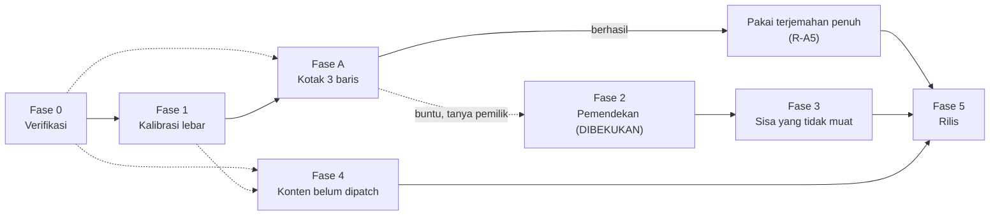

# Haganai Portable: Patch Teks Inggris

by: KangJiho · Terakhir diperbarui: 2026-10-22 (rilis v30: sisa overflow setelah v27 selesai ditulis ulang; CSV dipindah ke `scripts tools\csv`)

Proyek menerjemahkan **Boku wa Tomodachi ga Sukunai Portable (PSP, ULJS00459)** ke bahasa Inggris dengan mengedit `RES.DAT` langsung.

> Dokumen ini **menggantikan** README ringkas dan README lengkap sebelumnya. Isinya gabungan keduanya: status, **roadmap**, panduan kerja, temuan engine, dan data mentah file asli, disusun dari yang paling sering dibaca ke yang paling jarang.

> **ARAH PROYEK (keputusan pemilik, 2026-10-19; baca ini dulu):** pemilik proyek **tidak mau lanjut memotong atau memendekkan terjemahan** batch demi batch, karena maknanya jadi berkorban dibanding arti Jepang aslinya. Targetnya sekarang: **membuat kotak teks muat 3 baris** (geser teks naik dan/atau kecilkan font), lalu memakai lagi terjemahan penuh dari `haganai_dialogue_EN_v2.csv` dan `haganai_remaining_EN_full_v2.csv`. Pemendekan (batch 17 dan seterusnya) **dibekukan**: jangan menulis batch pemendekan baru kecuali pemilik memintanya lagi. Langkah kerjanya ada di [Fase A](#33b-fase-a-kotak-3-baris-prioritas-utama-sejak-2026-10-19).

> **UPDATE 2026-10-20 (baca ini juga):** **Patch geser teks `EBOOT_Y13.BIN` BERHASIL di PPSSPP v1.20.4**: teks dialog naik 13 px dan 3 baris muat di kotak ([7.8](#78-hasil-tes-geser-y-eboot-dan-varian-envpspdat-2026-10-20)). Jalur `envpsp.dat` tidak lagi dibutuhkan. Keputusan pemilik: **pakai terjemahan penuh** (`haganai_remaining_EN_full_v2.csv` dan `haganai_dialogue_EN_v2.csv`, tanpa dipendekkan). Sisa pekerjaan: pemenggalan baris 3 baris di pipeline, dan teks pilihan (choice) ikut naik sehingga tidak sejajar dengan balonnya.

> **UPDATE 2026-10-20 malam (build v14, baca ini juga):** terjemahan penuh sudah **dibuild dan dites pertama kali** (`RES_patched_v14.DAT` + `first_new_v14.dat` + `EBOOT_Y13.BIN`). Pipeline dan seekmap lolos (0 mismatch). Screenshot tes menemukan **tiga masalah**: (1) kutip ganda ASCII `"` tampil sebagai ♠, (2) huruf pertama kata berikutnya masih nyelip di ujung baris (pad 37 < kapasitas sekitar 38), (3) teks yang jadi 4 baris terpotong di baris ke-4. Rincian di [12.7](#127-build-v14-terjemahan-penuh-dan-tes-pertama-2026-10-20).

> **UPDATE 2026-10-21 (Progres Pemolesan Narasi v15 & Status Persentase, BACA INI):** 
> 1. **Penerjemahan & Patch Teks Utama:** **93,1%** instruksi game (21.128 / 22.693 instruksi) telah berhasil di-patch dan dibuild ke `RES_patched_v14.DAT` + `first_new_v15.dat` + `EBOOT_Y13.BIN`. Sisa 6,9% adalah *scene title* (673) dan *banter* (610) yang masih dibiarkan Jepang/menunggu reverse engineering opcode.
> 2. **Pemolesan Narasi (rilis v25_clean):** **286 baris narasi unik** (4,92% dari 5.817) berbeda dari v6 dan sudah direstrukturisasi gaya bahasanya. Dicatat di `changelog_v25_clean.csv` (576 entri: 260 dialog + 316 narasi). Catatan: angka lama "814 baris (13,99%)" di README v19/v25 **salah**, karena 512 entri changelog tidak mengubah teks (`before` = `after`) dan sudah dibuang. Tanda pisah panjang "—" dan elipsis "…" diganti "--" dan "..." (karakter berisiko ♠).
> 3. **UI & Patch Engine:** Patch Y13 (kotak 3 baris) dan Menu Judul Inggris **100% SELESAI**. Menu Pause / Backlog dalam tahap identifikasi aset.

> **UPDATE 2026-10-23 (menu sistem v2 DITES, menu Extras Inggris DIPASANG; BACA INI):** tes `menu_patch_v2` di PPSSPP v1.20.4 (build v30) menunjukkan judul System Menu, Backlog, Keyword List, header Options, dan label tombol **tampil Inggris**; pemilik menilai Keyword List dan Options "aman". Sisa yang terlihat Jepang atau cacat: menu Extras (ikon dan judul layar), dialog konfirmasi kembali ke judul, info chapter (`プロローグ`), judul tab Options terpotong, judul Keyword List terpotong di tepi kanan, `戻る` di Keyword List, serta dialog Inggris dengan jarak antar-huruf lebar dan kata terpotong di tengah (`fro / m`). Untuk Extras, `out_menu.rar` dibongkar ulang dan **20 sprite Inggris dibuat** (`menu_patch_v3.zip`: banner `Extras`, 5 judul layar, 14 label ikon); dipasang ke `RES_patched_v30.DAT` (**62 sprite dipatch, 0 `too big`**, seekmap 15.698/15.698 cocok). **Pemilik melaporkan menu Extras Inggris "bisa" di game** (belum ada screenshot rinci soal label terpotong). Skrip pencari string untuk dialog konfirmasi, nama pembicara, dan info chapter (`cari_string.py`) sudah dibuat tetapi **belum dijalankan**. Rincian di [7.12](#712-sprite-extras-dan-hasil-tes-menu-v2-2026-10-23) dan [12.13](#1213-menu-extras-inggris-dan-pasang-menu_patch_v3-2026-10-23).

> **UPDATE 2026-10-22 (batch overflow v27 SELESAI, BACA INI):** daftar teks > 3 baris `overflow_v27.csv` (**1.644 teks**: dialog 970, narasi 674) sudah **100% ditulis ulang** lewat `fix_batch2_v27.csv` sampai `fix_batch17_v27.csv` (1.679 baris; 35 di antaranya dari daftar overflow versi lama). Ini mengikuti opsi "pendekkan hanya yang tembus 3 baris" dari keputusan terbuka di [12.7](#127-build-v14-terjemahan-penuh-dan-tes-pertama-2026-10-20); terjemahan lain **tidak disentuh**. **Narasi (674) sudah masuk** ke `haganai_remaining_EN_full_v27.csv` (changelog di `changelog_v27.csv`). **Dialog (1.005) belum diterapkan** karena CSV dialog tidak diunggah; semuanya digabung di `fixes_dialog_v27_all.csv`. Rincian dan langkah berikutnya di [12.10](#1210-batch-overflow-v27-2026-10-22). Catatan: "batch 17" di arah proyek di atas adalah seri `fixes_batch` lama (kotak 2 baris); seri `fix_batch*_v27` ini terpisah.

> **UPDATE 2026-10-22 (sisa overflow setelah v27, rilis v30, BACA INI):** deteksi ulang sesudah v27 masih menyisakan **131 teks > 3 baris** (`overflow_after_v27.csv`: dialog 130, narasi 1; 4 baris: 95, 5 baris: 34, 6 baris: 2). Semuanya sudah **ditulis ulang dalam 3 batch** (v28, v29, v30) dan **dimasukkan ke CSV**: `haganai_dialogue_EN_v30.csv` (130 baris berubah dari v27) dan `haganai_remaining_EN_full_v30.csv` (1 baris narasi berubah). Panjang teks baru 72 sampai 97 karakter, **belum dicek lewat pipeline atau dites di game**. Rincian di [12.11](#1211-sisa-overflow-setelah-v27-rilis-v28-sampai-v30-2026-10-22). **Lokasi file berubah:** semua CSV kerja sekarang ada di `scripts tools\csv`, bukan lagi di `scripts tools` ([4.6](#46-lokasi-file-setelah-dipindah-2026-10-22)).

> **UPDATE 2026-10-20 (menu judul SELESAI, menu pause/backlog berikutnya, baca ini juga):** menu judul (NEW GAME, CONTINUE, EXTRAS, OPTIONS, INSTALL, TUTORIAL) **sudah Inggris di game** (konfirmasi pemilik + screenshot PPSSPP v1.20.4, paket `menu_patch` lewat [7.9](#79-patch-sprite-menu-judul-2026-10-20)). Yang **belum** diterjemahkan adalah menu saat pause di dalam game. Screenshot layar **Backlog** (バックログ) menunjukkan judul layar, label tombol (バックジャンプ, 表示切替, 再生, 戻る), dan judul scene (プロローグ) masih Jepang. Temuan, kandidat lokasi, dan daftar yang dibutuhkan ada di [7.10](#710-menu-pause-dan-backlog-2026-10-20), item [R4.7](#36-fase-4-konten-yang-belum-dipatch).

> **UPDATE 2026-10-22 (menu sistem, Options, Auto/Skip: sprite Inggris sudah DIBUAT, belum dites di game; BACA INI):** tes build v30 di PPSSPP menunjukkan masih Jepang: judul `システムメニュー`, info chapter (`プロローグ` / `テラス` / `ゆるやかな昼`), tombol `オート`, dialog konfirmasi (`タイトルに戻ります。よろしいですか？`, `システムデータを保存しますがよろしいですか？`, `はい / いいえ / 戻る`), nama pembicara (`夜空`, `星奈`), menu Extras (ブロック崩し dst.), dan header Options (`オプション`, `文章の設定`, `音楽の設定`, `その他の設定`). Setelah `out_menu.rar` dibongkar, **sebagian besar ternyata sprite GIM** (judul layar, tab Options, Auto/Skip). **16 sprite Inggris baru sudah dibuat** dan dikemas di `menu_patch_v2.zip` (diuji pada container `image_main.dat` dan `image_title.dat`: 0 `too big`, semua entri tetap terbaca). Yang **bukan sprite** dan belum ketemu lokasinya: info chapter, dialog konfirmasi, nama pembicara. Daftar lengkap, pemetaan sprite, dan langkah pasang ada di [7.11](#711-inventaris-sprite-ui-dan-sprite-inggris-baru-2026-10-22); riwayat di [12.12](#1212-menu-sistem-options-dan-autoskip-build-v30-2026-10-22).

## Daftar isi

1. [Gambaran proyek](#1-gambaran-proyek)
2. [Status sekarang](#2-status-sekarang)
3. [Roadmap](#3-roadmap)
4. [Folder, skrip, dan data](#4-folder-skrip-dan-data)
5. [Cara menjalankan](#5-cara-menjalankan)
6. [Aturan kerja](#6-aturan-kerja)
7. [Temuan tentang engine game](#7-temuan-tentang-engine-game)
8. [Format data game](#8-format-data-game)
9. [Opsi untuk teks > 2 baris](#9-opsi-untuk-teks--2-baris)
10. [Gerbang sebelum build dianggap beres](#10-gerbang-sebelum-build-dianggap-beres)
11. [Jebakan dan pelajaran](#11-jebakan-dan-pelajaran)
12. [Riwayat](#12-riwayat)
13. [Lampiran: pencocokan klaim dengan data asli](#13-lampiran-pencocokan-klaim-dengan-data-asli)

Bagian baru: [7.7 Hasil bongkar envpsp.dat](#77-hasil-bongkar-envpspdat-2026-10-19), [7.8 Hasil tes geser Y EBOOT dan varian envpsp.dat](#78-hasil-tes-geser-y-eboot-dan-varian-envpspdat-2026-10-20), [7.9 Patch sprite menu judul](#79-patch-sprite-menu-judul-2026-10-20), [7.10 Menu pause dan backlog](#710-menu-pause-dan-backlog-2026-10-20), [4.7 Folder Ui menu](#47-folder-ui-menu-untuk-semua-berkas-menuui-2026-10-22), [7.11 Inventaris sprite UI dan sprite Inggris baru](#711-inventaris-sprite-ui-dan-sprite-inggris-baru-2026-10-22), [12.12 Menu sistem, Options, dan Auto/Skip (build v30)](#1212-menu-sistem-options-dan-autoskip-build-v30-2026-10-22), [12.10 Batch overflow v27](#1210-batch-overflow-v27-2026-10-22), [12.11 Sisa overflow setelah v27](#1211-sisa-overflow-setelah-v27-rilis-v28-sampai-v30-2026-10-22), [4.6 Lokasi file setelah dipindah](#46-lokasi-file-setelah-dipindah-2026-10-22), [7.12 Sprite Extras dan hasil tes menu v2](#712-sprite-extras-dan-hasil-tes-menu-v2-2026-10-23), [12.13 Menu Extras Inggris dan pasang menu_patch_v3](#1213-menu-extras-inggris-dan-pasang-menu_patch_v3-2026-10-23)

---

## 1. Gambaran proyek

### Alur kerja

```
extract.py            CSV terjemahan (kolom english_text)
  RES.DAT asli  --->  FULL_dialogue_wrap_fixed.csv + FULL_remaining_wrap_fixed.csv
                                 |
                                 v   pipeline.py   (wrap + padding otomatis)
                       RES_patched_vN.DAT
                                 |
                                 v   seekmap_rebuild.py   (first.dat asli sebagai dasar)
                       first_new_vN.dat
                                 |
                                 v
                       Tes di PPSSPP (pasangan RES + first.dat harus dari build yang sama)
```

1. Teks Jepang diekstrak ke CSV (satu baris = satu dialog, narasi, atau pilihan).
2. Terjemahan Inggris ditulis di kolom `english_text`.
3. `pipeline.py` menyuntikkan teks Inggris ke `RES.DAT` (wrap dan padding otomatis).
4. `seekmap_rebuild.py` membuat `first.dat` yang cocok dengan `RES.DAT` baru.
5. Tes di PPSSPP.

### Masalah utama

**Kotak teks hanya muat 2 baris.** Terjemahan Inggris sering jadi 3 atau 4 baris sehingga baris ke-3 terpotong. Cara lama: **memendekkan terjemahan batch demi batch** (`fixes_batchN.csv`, 1.429 baris; **dibekukan 2026-10-19**). Cara yang dituju sekarang: **membuat kotak muat 3 baris** lewat geser teks naik dan mengecilkan font ([Fase A](#33b-fase-a-kotak-3-baris-prioritas-utama-sejak-2026-10-19), [7.6](#76-hasil-bongkar-eboot-2026-10-19)). Pecah dialog jadi dua kotak ([bagian 9](#9-opsi-untuk-teks--2-baris)) jadi cadangan.

### Folder kerja

| Folder | Isi |
|---|---|
| `D:\Reverse engginering\project haganai\scripts tools` | semua skrip `.py`, hasil build (`RES_patched_*`, `first_new_*`), dan subfolder kerja. **Semua perintah dijalankan dari sini** |
| `D:\Reverse engginering\project haganai\scripts tools\csv` | **semua CSV kerja** (117 item per 2026-10-22), dipindah dari `scripts tools`; lihat [4.6](#46-lokasi-file-setelah-dipindah-2026-10-22) |
| `D:\Reverse engginering\project haganai\script_output\translate dialogue` | CSV sumber terjemahan |
| `D:\Reverse engginering\project haganai\data ekstrak` | game asli: `RES.DAT`, `first.dat`, `EBOOT.BIN` |

---

## 2. Status sekarang

| Bidang | Progres (%) / Status |
|---|---|
| **Arah proyek** | **Pemendekan dibekukan.** Terjemahan penuh dipakai lagi. Kotak muat 3 baris **100% Terbukti** lewat geser Y (`EBOOT_Y13.BIN`) |
| **Injeksi Teks Game (Patch v14)** | **93.1% Selesai** (21.128 / 22.693 instruksi berhasil disuntikkan ke `RES.DAT`). Sisa 6.9% adalah *scene title* (673) & *banter* (610) |
| **Terjemahan Teks Dialog (15.257 baris)** | **100% Selesai** (Bahasa Inggris utuh di `haganai_dialogue_EN_v2.csv`) |
| **Terjemahan Teks Remaining (7.436 baris)** | **100% Selesai** (Bahasa Inggris utuh di `haganai_remaining_EN_full_v27.csv`, turunan `v26_clean`) |
| **Pemolesan Narasi (286 / 5817 baris)** | **4,92% Dipoles** (286 baris narasi berbeda dari v6; `changelog_v25_clean.csv` 576 entri) |
| **Teks > 3 Baris (overflow v27)** | **100% Ditulis ulang** (1.644 / 1.644 teks di `fix_batch2_v27` sampai `fix_batch17_v27`). Narasi 674/674 **sudah diterapkan** ke `haganai_remaining_EN_full_v27.csv`; dialog 970/970 ditulis ulang dan diterapkan lewat `apply_dialog_v27.py` ke `haganai_dialogue_EN_v27.csv` (**922 dari 1.005 fix masuk, 83 tidak cocok**, lihat `apply_dialog_v27_mismatch.csv` dan [12.10](#1210-batch-overflow-v27-2026-10-22)), belum dites di game |
| **Sisa Overflow setelah v27 (131 teks)** | **100% Ditulis ulang** (dialog 130 + narasi 1, batch v28 sampai v30) dan **sudah diterapkan** ke `haganai_dialogue_EN_v30.csv` dan `haganai_remaining_EN_full_v30.csv`; belum dicek ulang di pipeline dan belum dites di game |
| **Geser Y EBOOT (3 Baris Teks)** | **100% Selesai** (`EBOOT_Y13.BIN` berhasil di PPSSPP v1.20.4, 3 baris muat penuh) |
| **Menu Judul (UI Sprite)** | **100% Selesai** (NEW GAME, CONTINUE, EXTRAS, OPTIONS, INSTALL, TUTORIAL tampil Inggris di game) |
| **Menu Pause / Backlog / Options / Extras (sprite UI)** | **~75% (perkiraan)**: judul System Menu, Backlog, Keyword List, header Options, dan label tombol **tampil Inggris di game** (screenshot 2026-10-23). Sprite menu Extras (banner, 5 judul layar, 14 label ikon) dibuat dan dipasang di `menu_patch_v3.zip`; pemilik melaporkan "bisa". **Belum:** dialog konfirmasi, nama pembicara, info chapter (bukan sprite, lokasi belum ketemu), tab Options dan judul Keyword List terpotong, `戻る` di Keyword List ([7.12](#712-sprite-extras-dan-hasil-tes-menu-v2-2026-10-23)) |
| **Teks Pilihan (Choice)** | **100% Selesai** (365 baris terjemahan terisi, 0 kosong) |
| **Rebuild Seekmap (`first.dat`)** | **100% Selesai** (15.698/15.698 node cocok, 0 mismatch) |

**Penghalang terbesar (diperbarui 2026-10-20):** (1) ~~belum ada patch 3 baris~~ **selesai dengan Y13**; sekarang yang menghalangi adalah choice yang tidak sejajar dan pemenggalan baris untuk 3 baris, dan (2) aturan lebar kolom belum terbukti di game, jadi angka sisa 5.341 (diukur untuk 2 baris) belum bisa dipercaya. Roadmap di bawah mengerjakan keduanya, dan **tidak menulis batch pemendekan baru**.

---

## 3. Roadmap

### 3.1 Peta fase



Garis putus-putus berarti **bisa dikerjakan paralel** atau hanya dipakai sebagai cadangan. Fase A tidak bergantung pada hasil Fase 1, tapi lebar baris akhirnya perlu dikalibrasi ulang setelah ukuran font diubah. Fase 4 sebagian besar tidak bergantung pada metrik lebar (reverse scene title dan banter), kecuali batas panjang choice yang butuh hasil Fase 1.

| Fase | Tujuan | Selesai bila |
|---|---|---|
| 0. Verifikasi | Pastikan fondasi benar sebelum menulis lebih banyak | v12 dites, `pipeline.py` versi `--width2` terpasang, skrip hasil perapian lolos |
| 1. Kalibrasi lebar | Tetapkan satu cara menghitung lebar baris yang terbukti di game | Lebar standar baru tercatat di bagian 6 dan `csv_tools.py` sama dengan `pipeline.py` |
| **A. Kotak 3 baris (prioritas)** | Buat kotak dialog dan narasi muat 3 baris, lalu pakai terjemahan penuh | Tes di game: 3 baris terbaca penuh, terjemahan penuh dipakai |
| 2. Pemendekan massal (**dibekukan**) | Cadangan bila Fase A buntu | Hanya dilanjutkan bila pemilik proyek memintanya lagi |
| 3. Sisa yang tidak muat | Tangani teks yang kalau dipotong kehilangan makna | Keputusan strategi diambil dan diterapkan |
| 4. Konten belum dipatch | Scene title, banter, batas choice, karakter berisiko | Tiap item punya keputusan: dipatch atau sengaja dibiarkan Jepang |
| 5. Rilis | Build final yang lolos semua gerbang | Semua kotak di [bagian 10](#10-gerbang-sebelum-build-dianggap-beres) tercentang |

### 3.2 Fase 0: Verifikasi

Urut dari yang paling murah.

- [ ] **R0.1 Pasang `pipeline.py` versi `--width2`.** Cek dengan `findstr /C:"--width2" pipeline.py` (harus ada keluaran). File hasil unduhan harus menimpa file lama di `scripts tools` (pilih Replace), bukan `pipeline (1).py`. *Kenapa:* tanpa ini build v13 hanya mencetak teks bantuan, lalu `seekmap_rebuild.py` gagal `FileNotFoundError`.
- [ ] **R0.2 Tes build v12 di PPSSPP.** Game baru, tanpa save state. Kalimat uji:
  - "Southern islands vary, but picture an eternal summer paradise."
  - "The odd-eyed blonde is Hasegawa Kobato, my sister. I’m Kodaka."
  - "Don’t get carried away, brat, or no more potato chips."

  Cek empat hal: huruf nyelip, kata terbelah, baris ke-3, baris kedua menjorok. *Kenapa:* memastikan masalah huruf nyelip masih terjadi di build terbaru.
- [ ] **R0.3 Periksa `skip_v12.csv`.** Dari 37 baris skip, 27 baris "ada english_text kosong" seharusnya sudah hilang karena `fill-todo` dijalankan. Sisa 10 baris `0000Index` aman diabaikan.
- [ ] **R0.4 Uji skrip hasil perapian pada data asli.** `python tests.py identity RES.DAT`, `python dump.py opcodes RES.DAT` (bandingkan dengan `jumpscan.txt` lama), dan `csv_tools.py short`. Parser seekmap bersama lebih ketat: baris tak dikenali sekarang menghentikan skrip dengan error.

**Keluar dari fase ini bila:** R0.1 sampai R0.4 selesai dan hasil R0.2 dicatat.

### 3.3 Fase 1: Kalibrasi lebar

Tujuan: berhenti menebak lebar kolom. Semua angka sisa overflow bergantung pada ini.

- [ ] **R1.1 Tes `ruler2`** untuk membuktikan atau menggugurkan teori dua kelas lebar ([7.3](#73-aturan-lebar-karakter-di-kode-eboot-belum-dibuktikan-di-game)).
  ```
  python calibrate.py ruler2 FULL_dialogue_wrap_fixed.csv dlg_ruler2.csv
  python pipeline.py RES.DAT dlg_ruler2.csv FULL_remaining_wrap_fixed.csv RES_ruler2.DAT --width 0
  python seekmap_rebuild.py build RES_ruler2.DAT first.dat first_ruler2.dat
  ```
  Prediksi bila teori benar: baris uji `.`, `’`, `…` patah di angka sekitar **24 sampai 25**; baris `i` patah di sekitar **39**. Hasil yang jauh dari itu berarti teori salah.
- [ ] **R1.2 Build dan tes v13** (`--width 36 --width2 38 --nwidth 38`, perintah di [5.2](#52-build)). Cek ulang empat hal yang sama dengan R0.2.
- [ ] **R1.3 Samakan `csv_tools.py` dengan `pipeline.py`.** Beri opsi lebar baris 2+ (dan metrik 7/10 bila R1.1 cocok). Tanpa ini hitungan sisa jadi terlalu besar.
- [ ] **R1.4 Hitung ulang sisa overflow** dengan `csv_tools.py fix` memakai lebar yang baru. Catat sebagai baseline baru di [12.1](#121-teks--2-baris-overflow).
- [ ] **R1.5 Tetapkan lebar standar** dan perbarui tabel di [bagian 6](#6-aturan-kerja).

**Aturan keputusan:**

| Hasil | Tindakan |
|---|---|
| R1.1 cocok (24 sampai 25 dan 39) | Ganti `cw`, `wrap_lines`, `wrap_pad` di `pipeline.py` dan hitungan lebar di `csv_tools.py` ke metrik 7/10 (huruf, angka, spasi, `:` = 7; lainnya = 10; kapasitas sekitar 39 x 7). Hitung ulang sisa |
| R1.1 tidak cocok | Buang teori; pakai hasil v13 apa adanya |
| v13 lolos | Jadikan 36/38/38 standar baru |
| v13 muncul kata terbelah | Fallback `--width 35 --width2 37 --nwidth 37` |
| Apostrof bermasalah | Coba `--apos-w 1` atau `--apos-w 2` |
| Baris kedua masih menjorok | Selidiki spasi pad yang melewati kapasitas ([7.1](#71-hasil-kalibrasi-ppsspp-v1204-scene-0011ess0)) |

**Keluar dari fase ini bila:** ada satu set lebar yang lolos tes di game dan kedua alat menghitungnya sama.

### 3.3b Fase A: Kotak 3 baris (prioritas utama sejak 2026-10-19)

**Alasan:** pemilik proyek tidak mau memotong terjemahan lagi karena maknanya berkorban terhadap arti Jepang aslinya. Di screenshot tes, baris ke-3 hanya terpotong separuh di tepi bawah layar, jadi menggeser teks naik sekitar 12 sampai 14 px dan/atau mengecilkan font kemungkinan cukup (perkiraan kasar dari screenshot jendela non-16:9, belum diukur). Tiga baris memberi ruang sekitar 50% lebih banyak dari dua baris, dan font yang lebih kecil juga menambah jumlah huruf per baris.

**Dasar teknis:** fungsi penggambar string menerima skala horizontal dan vertikal sebagai argumen float, dan nilai skala serta posisi dibaca dari data biner saat game mulai ([7.6](#76-hasil-bongkar-eboot-2026-10-19)). Artinya ukuran teks adalah angka yang bisa diubah, bukan batas keras engine.

- [~] **R-A1 (sebagian selesai 2026-10-19: file sudah ada, kandidat di [7.7](#77-hasil-bongkar-envpspdat-2026-10-19), pemetaan belum terbukti)** Ambil `envpsp.dat` dari ISO** (7-Zip, `PSP_GAME\USRDIR`) dan upload ke chat. Cocokkan dengan tanda tangan urutan baca di 7.6 untuk menemukan float skala dan nilai posisi di sekitarnya. Tanpa file ini nilai yang tersimpan tidak bisa dibaca.
- [ ] **R-A2 (belum; lihat 7.7)** Tentukan pemanggil yang menggambar kotak dialog dan narasi.** Ada 4 pemanggil fungsi penggambar string; kotak dialog mungkin memakai jalur lain. Cara: ubah satu nilai per tes lalu lihat apa yang berubah di PPSSPP, atau pakai debugger PPSSPP (menu Debug) dengan breakpoint di fungsi penggambar string (alamat saat jalan beda dari alamat di file karena ada basis modul).
- [x] **R-A3 (selesai 2026-10-20 lewat jalur EBOOT, bukan envpsp)** Eksperimen, satu perubahan per tes:** (a) kecilkan skala, (b) geser posisi Y naik, (c) gabungan. Catat nilai awal sebelum mengubah. Cek keterbacaan font di ukuran kecil dan pastikan baris ke-3 tidak menabrak tepi atas kotak.
- [x] **R-A4 (diputuskan 2026-10-20: patch instruksi di EBOOT terdekripsi, `patch_eboot.py`, Y13)** Putuskan cara patch:** ubah nilai di file data (`envpsp.dat` bila terbukti) atau patch instruksi di EBOOT terdekripsi. PPSSPP umumnya bisa menjalankan EBOOT terdekripsi di folder hasil extract; perlu dites.
- [ ] **R-A5 (3 baris sudah terbukti; terjemahan penuh dipilih pemilik 2026-10-20; **build v14 sudah dibuat dan dites 2026-10-20**, lihat 12.7)** Setelah 3 baris terbukti di game, pakai lagi terjemahan penuh.** Sumber penuh: `haganai_dialogue_EN_v2.csv` dan `haganai_remaining_EN_full_v2.csv` (belum di-wrap), atau cadangan `FULL_*_wrap.csv` (cek dulu apakah masih memuat teks sebelum pemendekan). `FULL_*_fixed.csv` sekarang berisi teks yang sudah dipendekkan 1.429 baris; **jangan dihapus**, simpan `fixes_batch*.csv` sebagai catatan.
- [ ] **R-A6 (berikutnya)** Samakan alat:** `pipeline.py` dan `csv_tools.py` ke `--max-lines 3` dan lebar baru sesuai skala font, lalu hitung berapa teks penuh yang masih > 3 baris.

- [ ] **R-A7 Choice sejajar dengan balon.** Geser Y global membuat teks choice naik 13 px sementara balon highlight (sprite terpisah) tidak ikut. Pilihan: (a) buat patch bersyarat: geser hanya bila Y awal (`$a3`) berada di rentang kotak dialog/narasi; (b) cari pemanggil glyph khusus choice; (c) geser balon naik 13 px lewat data UI.
- [ ] **R-A8 Pemenggalan kata.** Screenshot Y13 menunjukkan kata terpotong di batas kolom ("N / eighbors"). Pecah baris di spasi pada pipeline, dengan lebar sekitar 35 sampai 37 karakter per baris.

**Keluar dari fase ini bila:** 3 baris terbukti terbaca di game dan terjemahan penuh sudah dibuild. *(Bagian pertama terpenuhi 2026-10-20.)*

**Aturan keputusan:** bila semua jalur Fase A buntu, **tanya pemilik proyek dulu** sebelum kembali memotong teks. Jalur cadangan lain: pecah dialog jadi dua kotak ([9.2](#92-pecah-dialog-jadi-dua-kotak)).

### 3.4 Fase 2: Pemendekan massal (DIBEKUKAN)

**Status: dibekukan sejak 2026-10-19.** Pemilik proyek tidak mau lanjut memotong terjemahan. Bagian ini disimpan sebagai cadangan, bukan rencana aktif. Dulunya dikerjakan batch demi batch.

- [ ] **R2.1 Loop per batch:** buat worklist baru, tulis batch, terapkan, pastikan `ditolak: 0 | tidak ketemu: 0` ([5.1](#51-memendekkan-dialog-dan-narasi)).
- [ ] **R2.2 Prioritas scene yang paling sering dimainkan**, baris dengan `cut` terbesar lebih dulu.
- [ ] **R2.3 Laju:** 100 baris per batch; naik ke 200 bila tes game (R0.2 atau R1.2) lolos.
- [ ] **R2.4 Backup berkala:** salin `FULL_*_fixed.csv` ke folder lain dan simpan semua `fixes_batch*.csv`.
- [ ] **R2.5 Build uji berkala** supaya masalah tampilan ketahuan lebih awal, bukan di akhir.

Beban kerja pada baseline sekarang (5.341, akan berubah setelah Fase 1):

| Laju | Perkiraan jumlah batch |
|---|---|
| 100 per batch | sekitar 54 |
| 200 per batch | sekitar 27 |

Titik pantau (angka sisa total; ganti dengan baseline baru dari R1.4):

| Milestone | Sisa |
|---|---|
| M2.0 (sekarang) | 5.341 |
| M2.1 | sekitar 4.000 |
| M2.2 | sekitar 2.500 |
| M2.3 | sekitar 1.000 |
| M2.4 | 0 atau hanya sisa ber-`cut` besar yang diputuskan di Fase 3 |

**Keluar dari fase ini bila:** dialog dan narasi > 2 baris = 0, atau sisanya hanya teks yang sengaja diserahkan ke Fase 3.

### 3.5 Fase 3: Sisa yang tidak muat

Dimulai ketika yang tersisa adalah teks yang kalau dipotong kehilangan makna penting (kolom `cut` besar). Rekomendasi sementara: **hybrid** (pendekkan yang bisa, perlakukan khusus yang tidak bisa).

- [ ] **R3.1 Putuskan jalur** untuk sisa teks. Opsi ada di [bagian 9](#9-opsi-untuk-teks--2-baris).
- [ ] **R3.2 Jalur geser teks naik (12 sampai 14 px).** Terblokir: posisi Y belum ketemu. Langkah: petakan urutan pembacaan stream di loader `0x2c2024`, atau ubah rekaman `envpsp.dat` satu per satu di PPSSPP. Ukuran font juga belum diselidiki.
- [ ] **R3.3 Jalur pecah dialog jadi dua kotak.** Terblokir: opcode goto belum teridentifikasi. Langkah: buat `jumpscan2` sebagai **subcommand `dump.py`** (bukan file lepas), jalankan, kirim `jumpscan2.txt`; bila satu opcode mendominasi, itu goto dan operandnya bisa dipetakan. Lalu tes satu atau dua dialog sebelum dipakai massal dan periksa empat risiko di [9.2](#92-pecah-dialog-jadi-dua-kotak).
- [ ] **R3.4 Terapkan jalur terpilih** hanya pada teks yang butuh, bukan massal.

**Aturan keputusan:** bila kedua jalur masih terblokir saat Fase 2 selesai, sisa teks tetap dipendekkan dan dicatat sebagai kompromi.

### 3.6 Fase 4: Konten yang belum dipatch

Boleh paralel dengan Fase 2.

- [ ] **R4.1 Batas panjang choice** (22, 30, atau 38 kolom) lewat screenshot. Tes awal: 22 kolom muat; yang lebih panjang keluar dari gelembung tapi terbaca. Butuh hasil Fase 1 bila lebar standar berubah.
- [ ] **R4.2 Scene title (673 baris)**: reverse format opcode 700 atau biarkan Jepang. Catatan: op700 ada 674; kemungkinan `0000Index` ("INDEX") tidak diekstrak.
- [ ] **R4.3 Banter (610 baris)**: reverse format opcode 1012/1013/1014 (445/245/210 instruksi) atau biarkan Jepang.
- [ ] **R4.4 Karakter berisiko ♠**: `é`, `①`, `…`, `π` (sekitar 17 baris) diganti ekuivalen aman.
- [ ] **R4.5 Hal terbuka dari analisis data:** selisih 22 baris dialog (21.096 vs 21.074), 19 instruksi choice yang belum terurai, algoritma checksum seekmap dan apakah game memeriksanya ([8.9](#89-yang-belum-diketahui)).
- [x] **R4.6 Menu judul Inggris (sprite). Selesai 2026-10-20**, tampil Inggris di game. Sisa kosmetik: label terpotong di tepi sprite (lihat [7.9](#79-patch-sprite-menu-judul-2026-10-20)). Perintah asli tetap di 7.9.
- [~] **R4.7 Menu pause dan backlog Inggris (sebagian, 2026-10-23).** 16 sprite Inggris dari `menu_patch_v2` **sudah terpasang dan tampil Inggris di game** (screenshot PPSSPP 2026-10-23: System Menu, Backlog, Options, Keyword List). Sisa kosmetik: tab Options terpotong (`Text Settin`, `Music Set`, `Other Setting`), judul Keyword List terpotong di tepi kanan, `戻る` di Keyword List masih Jepang ([7.12](#712-sprite-extras-dan-hasil-tes-menu-v2-2026-10-23)). Sisa lain: R4.8, R4.10 sampai R4.12.
- [x] **R4.9 Menu Extras (おまけ). Sprite Inggris dibuat dan dipasang 2026-10-23** (`menu_patch_v3.zip`: banner `Extras` = image_main 64 / image_title 107, judul layar `Event CG` 0_3/0_6, `Movies` 0_49, `Music` 0_52, `Bonus Story` 0_86, `Scene Replay` 0_111, dan 14 label ikon 0_87 sampai 0_100). `patch_menu.py`: 62 sprite dipatch, 0 `too big`. Pemilik melaporkan "bisa" di game; **belum ada screenshot rinci** untuk label kecil (sekitar 8 px) yang mungkin kurang terbaca. Rincian di [7.12](#712-sprite-extras-dan-hasil-tes-menu-v2-2026-10-23).
- [ ] **R4.10 Dialog konfirmasi** (dikonfirmasi lagi di screenshot 2026-10-23: `タイトルに戻ります。よろしいですか？` dan `はい / いいえ` masih Jepang; `cari_string.py` sudah dibuat, **belum dijalankan**) (`タイトルに戻ります。よろしいですか？`, `システムデータを保存しますがよろしいですか？`, `はい / いいえ / 戻る`). **Bukan sprite** (tidak ada di 349 sprite `out_menu`); tampil sebagai teks font. Cari string Shift-JIS/UTF-16 di `ULJS00459_EBOOT.BIN` terdekripsi dan `envpsp.dat` (butuh keduanya diunggah lagi).
- [ ] **R4.11 Nama pembicara** (`夜空`, `星奈`, dst.). Script hanya menyimpan ID pembicara 0 sampai 6 ([8.7](#87-dialog-dan-narasi-opcode-100)); nama di kotak dialog diambil dari tabel. Dugaan (belum dibuktikan): tabel 8 nama di EBOOT atau `envpsp.dat`. Cari urutan nama Jepang berurutan (夜空, 星奈, 幸村, 理科, 小鳩, マリア, 天馬, 小鷹).
- [ ] **R4.12 Info chapter di menu pause** (`プロローグ` / `テラス` / `ゆるやかな昼`): tiga baris judul scene, lokasi, dan waktu. Kemungkinan besar bagian dari scene title opcode 700 (R4.8), belum dibuktikan.
- [ ] **R4.8 Judul scene di Backlog (プロローグ dll.).** Ini scene title (opcode 700, 673 baris) yang masih dilewati pipeline. Backlog menampilkannya, jadi R4.2 ikut menentukan tampilan Backlog. Butuh format opcode 700 (contoh scene asli, mis. `orig_0011ess0.obj`).

**Keluar dari fase ini bila:** tiap item punya keputusan tertulis.

### 3.7 Fase 5: Rilis

- [ ] **R5.1** Semua kotak di [bagian 10](#10-gerbang-sebelum-build-dianggap-beres) tercentang.
- [ ] **R5.2** Screenshot PPSSPP 3 sampai 5 sampel terparah: tidak terpotong, tidak ada kata terbelah.
- [ ] **R5.3** Build final; `first.dat` di-rebuild dan dipasang sepasang dengan `RES.DAT` dari build yang sama.
- [ ] **R5.4** Catat nama build dan MD5 pasangan final; simpan sebagai acuan.
- [ ] **R5.5** Arsipkan file tes dan build lama ([4.5](#45-yang-boleh-diarsipkan)); pertahankan pasangan final dan semua CSV kerja.

### 3.8 Ringkasan langkah terdekat

0. **Setelah tes v14 (2026-10-20):** (a) ganti `"` ASCII dengan karakter yang tampil benar (213 baris; tes varian dulu seperti `calibrate.py apos-test`), (b) pasang `--width2` di `pipeline.py` lalu build ulang dengan `--nwidth 38` (dialog `--width 36 --width2 38`) untuk menutup huruf nyelip, (c) tentukan nasib teks > 3 baris (`overflow_v14.csv`), (d) cek `skip_v14.csv` (37 choice).
0. **Menu pause/backlog (2026-10-20):** R4.7 dan R4.8 ([7.10](#710-menu-pause-dan-backlog-2026-10-20)). Menu judul (R4.6) sudah selesai
0. **Setelah tes menu v2 dan v3 (2026-10-23):** (a) jalankan `cari_string.py` pada `envpsp.dat`, `ULJS00459_EBOOT.BIN`, dan `RES.DAT` untuk R4.10 sampai R4.12; (b) sprite kecil yang tersisa: tab Options, judul Keyword List, `戻る`; (c) R-A8 (pemenggalan kata dan jarak antar-huruf dialog). Menu sistem v2 dan Extras v3 sudah terpasang ([7.12](#712-sprite-extras-dan-hasil-tes-menu-v2-2026-10-23))
0. **Baru 2026-10-20:** R-A7 (choice sejajar dengan balon) dan R-A8 (pemenggalan kata), lalu R-A5/R-A6 (build dengan terjemahan penuh `--max-lines 3`)
1. ~~R-A1: ambil `envpsp.dat`~~ (tidak dibutuhkan lagi)
2. R0.1 pasang `pipeline.py` `--width2` (bisa paralel)
3. R0.2 tes v12 di PPSSPP (bisa paralel)
4. R-A2 sampai R-A4: cari pemanggil kotak dialog, eksperimen skala dan posisi, pilih cara patch
5. R1.1 tes ruler2 dan R1.2 build v13, lalu R1.3 sampai R1.5
6. R-A5 dan R-A6: build dengan terjemahan penuh dan `--max-lines 3`

**Tidak ada batch pemendekan baru** sampai Fase A selesai atau pemilik meminta lagi.

---

## 4. Folder, skrip, dan data

### 4.1 Skrip

| File | Fungsi | Perintah / subcommand |
|---|---|---|
| `pipeline.py` | **Membangun `RES.DAT` baru**: memasukkan teks Inggris ke script game, wrap dan padding otomatis. File yang gagal parse atau verify **tidak dipatch** (Jepang asli utuh), alasannya masuk laporan skip | `python pipeline.py RES.DAT dialogue.csv remaining.csv OUT.DAT [opsi]`. Opsi: `--max-lines`, `--width`, `--width2`, `--nwidth`, `--report`, `--apos-w` |
| `seekmap_rebuild.py` | **Membuat `first.dat` baru** yang cocok dengan `RES.DAT` hasil build. Berisi `parse_seekmap`, parser tunggal yang juga dipakai `dump.py` dan `extract.py` | `python seekmap_rebuild.py build RES.DAT first.dat first_new.dat` |
| `csv_tools.py` | **Alat kerja CSV**: menghitung teks > 2 baris, membuat daftar kerja, menerapkan batch pemendekan, mengurus choice | `fix`, `short`, `choice-fixes`, `choice-short`, `choice-gaps`, `choice-missing`, `fill-todo`, `long-choices`, `encoding`, `verify-length` |
| `apply_dialog_v27.py` | **Menerapkan `fixes_dialog_v27_all.csv` ke CSV dialog** (kolom `file, offset, speaker, text, clean_text, english_text`). Pencocokan lewat nama file + offset (hex atau desimal). Teks lama di fix harus sama dengan `english_text` sekarang (apostrof dan kutip disamakan); yang tidak cocok **dilewati** (kecuali `--force`) dan dicatat ke `apply_dialog_v27_mismatch.csv`. Satu fix tidak diterapkan dua kali. BOM dan akhir baris CSV dipertahankan; kalau teks lama dibungkus 「」, bungkusnya dipertahankan | `python apply_dialog_v27.py csv\haganai_dialogue_EN_v6.csv csv\fixes_dialog_v27_all.csv csv\haganai_dialogue_EN_v27.csv [--force]` |
| `dump.py` | **Membongkar isi game** untuk analisis: struktur, instruksi, byte, teks, daftar opcode | `obj`, `inst`, `hex`, `tree`, `entry`, `scan`, `find`, `text`, `gpda-entry`, `seekmap-pos`, `opcodes` (dulu `jumpscan.py`) |
| `calibrate.py` | **Membuat build uji** untuk mengukur lebar baris, apostrof, dan tinggi kotak di PPSSPP | `ruler`, `ruler2`, `apos`, `apos-test`, `lines` |
| `tests.py` | **Tes keamanan** supaya build tidak merusak data | `identity`, `crosscheck`, `seekmap` |
| `extract.py` | **Ekstraksi awal** teks dari `RES.DAT` ke CSV dan cek dialog | `python extract.py ...` |
| `patch_eboot.py` | **Menggeser Y semua glyph** dengan mengubah satu instruksi di EBOOT terdekripsi (Y13 berhasil) | `python patch_eboot.py ULJS00459_EBOOT.BIN KELUARAN.bin [geser_px]` |
| `patch_menu.py` (di `menu_patch\`) | **Mengganti sprite menu judul Jepang dengan versi Inggris** di `RES.DAT`. Mencocokkan MD5 GIM asli (`originals.txt`), gzip ulang di slot yang sama, memperbarui ukuran entri di tabel GPDA. Hasil ditulis ke salinan `NAMA.DAT.patched`, **file asli tidak diubah** | `python patch_menu.py ..\RES_patched_v14.DAT` (butuh `menu_gims\` dan `originals.txt` di sebelahnya) |
| `menu_check.py` (di `menu_patch\`) | **Hanya membaca**: melaporkan tiap dari 12 sprite menu berstatus JEPANG, INGGRIS, atau tidak ditemukan | `python menu_check.py ..\RES_patched_v14.DAT.patched` |
| `tambah_extras.py` (di `menu_patch\`, dari `menu_patch_v3.zip`) | **Menambah 20 baris sprite Extras ke `originals.txt`**: membaca format baris yang sudah ada, memeriksa jenis MD5 (GIM terurai atau entri mentah) terhadap `out_menu`, mencadangkan `originals.txt.bak`, tidak menambah baris dua kali | `python menu_patch\tambah_extras.py menu_patch "Ui menu\out_menu"` |
| `cari_string.py` | **Hanya membaca**: mencari string Jepang dalam UTF-16LE, Shift-JIS, UTF-8, termasuk di dalam aliran gzip tertanam. Untuk R4.10 sampai R4.12. **Belum dijalankan** | `python cari_string.py <file> [teks ...]` |
| `cut_gpda.py` | **Hanya membaca**: memotong container GPDA tingkat atas dari `RES.DAT` atau `first.dat` menjadi file terpisah (kecil, bisa diunggah). Diuji pada GPDA sintetis, **belum pada `RES.DAT` asli** | `python cut_gpda.py RES.DAT list`; `python cut_gpda.py RES.DAT cut out_menu --small` atau dengan nama entri (`image_main.dat` dst.) |
| `envpsp_variants.py`, `envpsp_variant_D.py`, `envpsp_variant_E.py` | Varian uji `envpsp.dat` (jalur lama, tidak dipakai lagi) | `python envpsp_variants.py envpsp.dat [folder]` dst. |
| `jumpscan2.py` | Rencana: mencari opcode lompat (goto) lewat instruksi tepat sebelum awal cabang pilihan; menulis `jumpscan2.txt`. **Tidak ada di unggahan, belum dijalankan.** Kalau dibuat ulang, jadikan subcommand `dump.py` | n/a |

Skrip lepas buatan Claude (`apply_short.py`, `fill_todo.py`, `choice_gaps.py`, `shorten_pass.py`, `make_choice_fixes.py`) fungsinya sudah tercakup `csv_tools.py`; boleh diarsipkan.

Subcommand `csv_tools.py` yang dipakai rutin:

| Subcommand | Fungsi |
|---|---|
| `fix` | Menghitung teks > 2 baris, membuat daftar kerja (`--worklist`), atau **menerapkan** file `fixes_batchN.csv` ke CSV utama |
| `fill-todo` | Menggabungkan terjemahan choice yang tadinya kosong |
| `choice-fixes` | Menerapkan pendekan choice |
| `long-choices` | Mendaftar choice yang terlalu panjang |

(Fungsi subcommand lain belum dicatat rinci; lihat `--help`.)

### 4.2 CSV utama

> **Lokasi (sejak 2026-10-22):** semua CSV di bagian ini ada di `scripts tools\csv`, bukan di `scripts tools`. Lihat [4.6](#46-lokasi-file-setelah-dipindah-2026-10-22).

| File | Isi |
|---|---|
| `FULL_dialogue_wrap_fixed.csv` | 15.257 baris dialog ber-speaker |
| `FULL_remaining_wrap_fixed.csv` | 7.465 baris: narasi 5.817, scene title 673, banter 610, choice 365 |
| `FULL_dialogue_wrap.csv`, `FULL_remaining_wrap.csv`, `FULL_remaining_short.csv` | versi sebelum `fixed` (cadangan) |
| `haganai_dialogue_EN_v2.csv`, `haganai_remaining_EN_full_v2.csv` | CSV sumber terjemahan penuh (belum di-wrap, tanpa `\n`); dipakai build v14 |

**Beda dua CSV terjemahan penuh:**

| | `haganai_dialogue_EN_v2.csv` | `haganai_remaining_EN_full_v2.csv` |
|---|---|---|
| Isi | **Dialog ber-speaker** (ada nama pembicara, teks dibungkus 「…」) | Semua sisanya: narasi tanpa speaker, choice/menu, scene title, banter |
| Baris | 15.257 | 7.436 (narasi/dialog 5.817, banter 610, scene title 673, choice 336) |
| Kolom | `file, offset, speaker, text, clean_text, english_text` | `scene, inst_index, opcode, str_index, kind, jp_text, jp_clean, english_text` |
| Kunci pencocokan ke game | `file` + `offset` (posisi 「 di `.obj.bin`) | `scene` + `inst_index` (+ `str_index` untuk choice) |
| Opcode | 100 | 100 (narasi), 103 (choice) |
| Lebar wrap | `--width` | `--nwidth` (narasi saja; choice tidak di-wrap) |
| Dipatch pipeline | ya | narasi dan choice ya; scene title dan banter dilewati |

Keduanya saling melengkapi: dialog dengan pembicara ada di file pertama, teks lain di file kedua. Total 22.693 baris. Dua file ini dan unggahan ulang 2026-10-20 identik (MD5 sama).

**Penjelasan ringkas dialogue vs remaining (ditambahkan 2026-10-21):**

- **Dialogue** = ucapan karakter yang punya nama pembicara. Sebaran `speaker`: Kodaka (小鷹) 4.697 baris, Yozora (夜空) 2.646, Sena (星奈) 2.207, Rika (理科) 1.775, Kobato (小鳩) 1.241, Maria (マリア) 1.193, Yukimura (幸村) 1.135, Tenma (天馬) 120. Lokasi di game ditandai `file` + `offset`, karena diambil langsung dari file script `.obj.bin`. Contoh: Yozora, "Hey, Kodaka~!".
- **Remaining** = semua teks selain itu, tanpa nama pembicara. Diambil dari instruksi script, jadi kuncinya `scene` + `inst_index`. Kolom `kind` membedakan empat jenis:

| `kind` | Baris | Isi | Contoh | Status patch |
|---|---|---|---|---|
| `narration/dialog` | 5.817 | Narasi (monolog Kodaka, deskripsi) dan ucapan tanpa speaker | "Let me get one thing straight first--this is all a hallucination." | Dipatch. **Inilah yang dipoles di v15** |
| `scene title` | 673 | Judul scene | "Prologue" | Belum dipatch (tetap Jepang) |
| `banter line` | 610 | Obrolan selingan | "Sorry about that. Are you feeling better now?" | Belum dipatch (tetap Jepang) |
| `choice/menu` | 336 | Pilihan dan menu | "Hug her already!", "Go to index" | Dipatch |

Singkatnya: dialogue = ucapan para karakter; remaining = narasi, judul scene, obrolan selingan, dan pilihan.

**Versi file dan paket unggahan (per 2026-10-21):**

| Paket | Isi | Catatan |
|---|---|---|
| `translate_dialogue.rar` (v6, 2026-10-20) | `haganai_dialogue_EN_v6.csv`, `haganai_remaining_EN_full_v6.csv`, `changelog_v6.csv` (260 revisi dialog), README | Paket lengkap |
| `haganai_v15_update.zip` (v15, 2026-10-21) | `haganai_remaining_EN_full_v15.csv`, `changelog_v15.csv` (516 revisi: 260 dialog + 256 narasi), README | Update **parsial**: **tidak ada file dialogue** |
| `haganai_v19_update.zip` (v19) | `haganai_remaining_EN_full_v19.csv`, `changelog_v19.csv`, README | Parsial. Dilewati: baris poles paling panjang, digantikan v25 |
| `haganai_v25_final_release.zip` (v25) | `haganai_remaining_EN_full_v25.csv`, `changelog_v25.csv`, README | Parsial. Memuat "—" dan "…" yang berisiko tampil ♠ |
| **`v25_clean` (rekomendasi, 2026-10-21)** | `haganai_remaining_EN_full_v25_clean.csv`, `changelog_v25_clean.csv`, README | v25 dengan "—" menjadi "--" dan "…" menjadi "..." (13 baris), 512 entri changelog no-op dibuang |

- Dibanding v6, hanya file **remaining** yang berubah di v15: **234 baris narasi** (`narration/dialog`) dipoles gaya bahasanya. Riwayat revisi dialog di `changelog_v15.csv` identik dengan `changelog_v6.csv`, jadi file dialogue tidak ikut berubah.
- Karena paket update tidak membawa file dialogue, pakai kombinasi: `haganai_dialogue_EN_v6.csv` + `haganai_remaining_EN_full_v25_clean.csv` + `changelog_v25_clean.csv`.

**Perbandingan v15, v19, v25 (baris narasi berbeda dari v6):**

| | v15 | v19 | v25 | v25_clean |
|---|---|---|---|---|
| Baris narasi berubah vs v6 | 234 | 285 | 287 | 286 |
| Entri changelog narasi | 256 | 814 | 828 | 316 |
| Entri changelog no-op (`before` = `after`) | 5 | 512 | 512 | 0 |
| Baris dengan "—" | 0 | 2 | 8 | 0 |

Jangan percaya angka 814 / 13,99% di README v19 dan v25. Perubahan nyata sekitar 286 baris (4,92%). Gaya v25 lebih dramatis dan beberapa baris menambah detail yang tidak ada di v15 (misalnya "washed ashore"); cek ke teks Jepang bila ragu.
- **Peringatan panjang teks:** teks hasil poles rata-rata lebih panjang (sekitar 85 menjadi 97 karakter pada baris yang berubah). Baris di atas 140 karakter naik dari 2 menjadi 12, jadi ada risiko sedikit lebih banyak narasi yang melewati 3 baris. Cek ulang overflow setelah build berikutnya.

### 4.3 Tambalan pemendekan (`fixes_*.csv`)

Semua sudah diterapkan. Total **1.429 baris**.

| File | Baris | Catatan |
|---|---|---|
| `fixes_2baris_0011ess0.csv`, `fixes_batch01.csv`, `fixes_batch1.csv` | 24, 51, 24 | batch awal |
| `fixes_batch2.csv`, `fixes_batch4_narasi.csv` | 100, 100 | |
| `fixes_batch5.csv`, `fixes_batch6.csv`, `fixes_batch7.csv` | 40, 60, 80 | |
| `fixes_batch8.csv` | 100 | sisa 5.453 |
| `fixes_batch9.csv` | 150 | sisa 5.303 |
| `fixes_batch10.csv`, `fixes_batch11.csv` | 100, 100 | sisa 5.203 dan 5.103 (lebar bawaan) |
| `fixes_batch12.csv` | 100 | pindah ke lebar ketat 35/37, sisa 5.741 |
| `fixes_batch13.csv` sampai `fixes_batch15.csv` | 100 masing-masing | sisa 5.641, 5.541, 5.441 |
| `fixes_batch16.csv` | 100 | **diterapkan 2026-10-17**: `diterapkan: 100 \| ditolak: 0 \| tidak ketemu: 0`, sisa 5.341 |

- Kolom batch 10 ke atas: `type,scene,ref,speaker,jp,english_new,lines,cut`. Format batch lama berbeda: `batch01` = `sumber,scene,id,english_text`; `batch1` sampai `batch7` = `type,scene,ref,english_new`.
- Batch 10 sampai 12 ditulis dari `next_all.csv` (baris terparah dulu, `cut` terbesar). Batch 13 sampai 16 dari worklist yang dibuat ulang tiap kali dengan lebar ketat. Semua sudah diperiksa muat 2 baris, memakai `’`, dan batch 13 sampai 16 juga lolos terhadap lebar build v13 (dialog 36/38, narasi 38): 400 baris, tanpa apostrof ASCII atau kutip yatim.
- `next_all.csv` lama (5.453 baris, dibuat setelah batch 8) sudah usang; buat ulang tiap batch ([5.1](#51-memendekkan-dialog-dan-narasi)).

### 4.4 Choice dan hasil build

**Choice** (semua sudah diterapkan, lihat [5.3](#53-choice-sudah-dijalankan-2026-10-16-disimpan-sebagai-catatan)):

| File | Baris | Keterangan |
|---|---|---|
| `choice_full.csv` | 818 | semua entri choice 37 instruksi yang di-skip (kolom `status`) |
| `choice_todo.csv` | 29 | choice yang `english_text`-nya kosong |
| `choice_todo_terisi.csv` | 29 | terjemahannya; **sudah digabung** (`fill-todo`: 29 terisi, 0 tidak cocok) |
| `choice_fixes (1).csv` | 209 | usulan pendek (maks 22 kolom); **sudah diterapkan** (209/209) |
| `choice_fixes_todo.csv` | 20 | pendekan dari `choice_todo_terisi`; **sudah diterapkan** (20/20) |
| `choice_long.csv`, `choice_pendek.csv`, `choice_unik.csv`, `choice_terlalu_panjang.csv` | | daftar kerja lama |

**Hasil build dan laporan:**

| File | Fungsi |
|---|---|
| `RES_patched_vN.DAT` | hasil build `pipeline.py` |
| `first_new_vN.dat` | `first.dat` hasil `seekmap_rebuild.py`. **Selalu satu pasang dengan `RES_patched_vN.DAT`** |
| `skip_vN.csv` | laporan baris yang tidak dipatch |
| `dump_choice.txt`, `dump_fail.txt`, `dump_scene.txt` | dump byte instruksi choice (opcode 103) |
| `index_preview.txt` | isi `0000Index`; entri terakhir inst#110 = 戻る/Back, sisanya nama scene seperti `0048ess2`, `_omake_kob` |
| `jumpscan.txt` | daftar opcode (keluaran lama) |
| `dlg_ruler*.csv`, `rem_ruler.csv`, `dlg_lines.csv`, `rem_lines.csv`, `dlg_2baris.csv`, `rem_2baris.csv`, `TEST_*_0011ess0.csv`, `skip_ruler.csv`, `skip_test.csv` | hasil tes kalibrasi (boleh diarsipkan) |

**Laporan skip terbaru: 37 baris**, dua penyebab:

| Alasan | Jumlah | Artinya |
|---|---|---|
| `jumlah pilihan beda` | 10 | semua `0000Index` inst#101 sampai 110. Menu pemilih scene (debug), isinya nama scene. **Aman diabaikan** |
| `ada english_text kosong` | 27 | seharusnya sudah hilang karena `fill-todo` dijalankan; `skip_v12.csv` belum diperiksa |

### 4.5 Yang boleh diarsipkan

Pindahkan ke folder `arsip` dulu, hapus setelah v13 dites.

| Kategori | File |
|---|---|
| Sisa tes | `fixed_0011ess0.obj`, `new_0011ess0.obj`, `patched_0011ess0.obj` (`orig_0011ess0.obj` simpan hanya bila `tests.py crosscheck` mau dijalankan) |
| Hasil kalibrasi | `TEST_*_0011ess0.csv`, `dlg_ruler*.csv`, `rem_ruler.csv`, `dlg_lines.csv`, `rem_lines.csv`, `dlg_2baris.csv`, `rem_2baris.csv`, `skip_ruler.csv`, `skip_test.csv`, `first_ruler*.dat`, `first_lines.dat`, `RES_lines.DAT` |
| Build lama | `RES_patched_v3` sampai `v11`, `first_new_v3` sampai `v11` (+ `first_v5.dat`, `first_v5b.dat`, `*_test.*`). **Simpan pasangan v12** sampai v13 dites |
| Backup CSV | `FULL_*_fixed.csv.bak` dan salinan ber-timestamp (`.2026101x_...`): simpan yang terbaru saja |
| **Jangan dihapus** | `FULL_*_fixed.csv`, `fixes_batch*.csv`, `choice_*.csv` berstatus diterapkan, `index_preview.txt`, `jumpscan.txt` |

### 4.6 Lokasi file setelah dipindah (2026-10-22)

Dicatat dari screenshot Explorer yang dikirim pemilik (tiga gambar; daftar file bisa lebih panjang dari yang terlihat di layar). Perubahannya: **semua CSV kerja dipindah dari `scripts tools` ke subfolder `scripts tools\csv`**. Skrip, hasil build, dan file lain tetap di `scripts tools`.

| Lokasi | Isi |
|---|---|
| `D:\Reverse engginering\project haganai\scripts tools` | skrip, hasil build, backup, subfolder kerja (rincian di bawah) |
| `D:\Reverse engginering\project haganai\scripts tools\csv` | semua CSV kerja (117 item) |

**Isi `scripts tools`:**

| Kelompok | File / folder |
|---|---|
| Subfolder | `__pycache__`, `csv` (**baru**), `envpsp_variants`, `menu_patch`, `out_menu`, `out_v14_menu`, `out_v27` |
| Skrip `.py` yang terlihat | `apply_dialog_v27.py` (menerapkan perbaikan dialog v27, lihat [4.1](#41-skrip)), `calibrate.py`, `csv_tools.py`, `cut_gpda.py`, `dump.py`, `extract.py`, `patch_envpsp.py`, `pipeline.py`, `seekmap_rebuild.py`, `tests.py` |
| Hasil build | `RES_patched_v3` sampai `v12`, `v14`, `v25`, `v27` (`.DAT`); `first_new_v3` sampai `v12`, `v14`, `v25`, `v27` (`.dat`); `first_new_v14_menu.dat`, `first_new_v27_menu.dat`; `RES_patched_v14.DAT.patched`, `RES_patched_v27.DAT.patched` |
| Sisa tes dan kalibrasi | `RES_lines.DAT`, `RES_patched_test.DAT`, `first_lines.dat`, `first_new_test.dat`, `first_ruler.dat`, `first_ruler2.dat`, `first_v5.dat`, `first_v5b.dat`, `fixed_0011ess0.obj`, `new_0011ess0.obj`, `orig_0011ess0.obj`, `patched_0011ess0.obj` |
| Backup CSV lama (tetap di sini) | `FULL_dialogue_wrap_fixed.csv.bak`, `FULL_remaining_wrap_fixed.csv.bak`, dan 4 salinan ber-timestamp `FULL_remaining_wrap_fixed.csv.20261015_131032.bak`, `.20261015_201754.bak`, `.20261016_092857.bak`, `.20261016_092859.bak` |
| Lain-lain | `envpsp.dat`, `menu_patch.zip`, `out_menu.rar`, `README.md`, `dump_choice.txt`, `dump_fail.txt`, `dump_scene.txt`, `index_preview.txt`, `jumpscan.txt`, empat file `.png` |

**Isi `scripts tools\csv` (117 item):**

| Kelompok | File |
|---|---|
| Terjemahan utama dialog | `haganai_dialogue_EN_FIXED.csv`, `_v2`, `_v3_fixed`, `_v6`, `_v27`, `_v28`, `_v29`, **`_v30`** (terbaru) |
| Terjemahan utama remaining | `haganai_remaining_EN_full.csv`, `_v2`, `_v3_fixed`, `_v6`, `_v25_clean`, `_v26_clean`, `_v27`, **`_v30`** (terbaru) |
| Daftar overflow | `overflow.csv`, `overflow_report.csv`, `overflow_v14`, `_v25`, `_v27`, `overflow_after_v27`, `_v28`, `_v29` |
| Batch pemendekan | `fix_batch2_v27` sampai `fix_batch17_v27`, `fixes_batch1`, `fixes_batch01`, `fixes_batch2` sampai `fixes_batch16`, `fixes_batch4_narasi`, `fixes_dialog_v27_all`, `fixes_2baris_0011ess0` |
| Log perubahan | `changelog.csv`, `changelog_v6`, `changelog_v25_clean`, `changelog_v27`, `apply_dialog_v27_mismatch.csv` |
| Choice | `choice_fixes`, `choice_fixes (1)`, `choice_fixes_todo`, `choice_full`, `choice_long`, `choice_pendek`, `choice_terlalu_panjang`, `choice_todo`, `choice_todo_terisi`, `choice_unik`, `remaining_choice_short` |
| Laporan build | `skip.csv`, `skip_v3`, `skip_v3_narasi`, `skip_v4` sampai `skip_v12`, `skip_v14`, `skip_v25`, `skip_v27`, `skip_ruler`, `skip_test` |
| Berkas `FULL_*` lama | `FULL_dialogue_wrap`, `FULL_dialogue_wrap_fixed`, `FULL_remaining_short`, `FULL_remaining_wrap`, `FULL_remaining_wrap_fixed` |
| Kalibrasi dan tes | `dlg_2baris`, `dlg_lines`, `dlg_ruler`, `dlg_ruler2`, `rem_2baris`, `rem_lines`, `rem_ruler`, `TEST_apos_dialogue_0011ess0`, `TEST_apos_remaining_0011ess0`, `TEST_dialogue_wrap_0011ess0`, `TEST_jp_dialogue_0011ess0`, `TEST_jp_remaining_0011ess0`, `TEST_remaining_wrap_0011ess0` |
| Daftar kerja dan lain-lain | `next.csv`, `next_all.csv`, `next_narasi.csv`, `dialogue_export.csv`, `remaining_final.csv`, `remaining_short.csv`, **`README.md`** |

**Akibat pemindahan (belum diuji, cek sendiri):**

- Perintah yang menerima CSV lewat argumen harus memakai path baru, mis. `python pipeline.py "...\data ekstrak\RES.DAT" csv\haganai_dialogue_EN_v30.csv csv\haganai_remaining_EN_full_v30.csv RES_patched_vN.DAT ...`. Perintah dijalankan dari `scripts tools`, jadi keluaran seperti `--report skip_vN.csv` dan `--overflow overflow_vN.csv` ikut ditulis di `scripts tools` kecuali diberi awalan `csv\`.
- **Sudah dicek (kode `csv_tools.py` dan `apply_dialog_v27.py` dibaca 2026-10-22):** tidak ada path CSV yang tertanam; semua CSV masuk lewat argumen, jadi cukup beri awalan `csv\`. Hal yang perlu diingat:
  - `csv_tools.py` mengimpor `pipeline.py` dari folder tempat skripnya berada, jadi `csv_tools.py` dan `pipeline.py` harus tetap berdampingan di `scripts tools`.
  - `csv_tools.py fix` menulis `*_fixed.csv` dan backup `.bak` **di folder yang sama dengan file masukan**, jadi kalau masukannya `csv\FULL_...`, hasil dan backup baru ikut masuk `csv`. Subcommand `choice-fixes` dan `choice-short` juga menulis backup di sebelah file masukan.
  - Keluaran yang namanya tidak diberi path ditulis di folder tempat perintah dijalankan (`scripts tools`): `index_preview.txt` (`choice-missing`, selalu), `choice_terlalu_panjang.csv` (bawaan `long-choices`), `fixed_output.csv` (bawaan `encoding`), `verify_report.csv` (bawaan `verify-length`), dan **`apply_dialog_v27_mismatch.csv`** (nama tertanam di `apply_dialog_v27.py`; file di `csv` berarti sudah kamu pindahkan, atau perintahnya dijalankan dari folder itu). Beri `csv\` di `--out`, `--output`, atau `--worklist` kalau mau hasilnya langsung masuk `csv`.
- **`README.md` ada di dua tempat** (`scripts tools` dan `scripts tools\csv`). Jadikan satu saja sebagai induk (disarankan di `scripts tools`, bersama skrip) dan arsipkan salinan satunya supaya tidak ada dua versi berbeda; sumber kebenaran tetap yang bertanggal terbaru ([bagian 11](#11-jebakan-dan-pelajaran)).
- Backup `FULL_*.csv.bak` masih di `scripts tools`, sedangkan `FULL_*_fixed.csv` ada di `csv`; kalau mau dirapikan, pindahkan backup ke `csv` juga atau ke folder `arsip` ([4.5](#45-yang-boleh-diarsipkan)).

### 4.7 Folder `Ui menu` untuk semua berkas menu/UI (2026-10-22)

Dicatat dari screenshot Explorer dan keterangan pemilik: berkas yang berkaitan dengan menu dan sprite UI dikumpulkan di **`D:\Reverse engginering\project haganai\scripts tools\Ui menu`**. Yang terlihat di screenshot (8 item):

| Item | Isi |
|---|---|
| `out_menu` | container GPDA hasil `cut_gpda.py --small` (versi terekstrak dari `out_menu.rar`; sumber pembongkaran sprite di [7.11](#711-inventaris-sprite-ui-dan-sprite-inggris-baru-2026-10-22)) |
| `out_v14_menu` | pasangan `RES.DAT` + `first.dat` build v14 dengan menu judul Inggris |
| `out_v27` | pasangan build v27 |
| `out_v30` | pasangan build v30 dengan menu judul Inggris (`RES.DAT` hasil `patch_menu.py` + `first.dat` dari `first_new_v30_menu.dat`); **menu judul dikonfirmasi Inggris di game** |
| `menu_patch.zip` | paket sprite menu judul lama (12 GIM) |
| `menu_patch_v2.zip` | paket sprite baru: 12 lama + 16 baru (System Menu, Backlog, Details, Flowchart, Keyword List, Load, Save, Quick Load, Options, tab Options, Auto/Skip); **belum dites di game** |
| `menu_patch_v3.zip` | paket baru (2026-10-23): 20 GIM Inggris untuk menu Extras (`menu_gims\title_*.gim`, `main_64_extras_banner.gim`), `extras_md5.txt`, `tambah_extras.py`, `preview_extras_english.png`. Diekstrak ke `scripts tools` (bukan ke `Ui menu`) |
| `preview_menu_ui_english.png` | preview sprite baru dibanding aslinya |
| `out_menu.rar` | arsip `out_menu` yang dikirim ke chat |

**Dampak ke perintah di README:** perintah yang menulis atau membaca `.\out_v30`, `.\out_v14_menu`, `.\out_v27`, `.\out_menu`, dan `menu_patch.zip` sebelumnya mengandaikan folder itu ada langsung di `scripts tools`. Sekarang tambahkan awalan `"Ui menu\"` (mis. `".\Ui menu\out_v30\RES.DAT"`) atau jalankan dari dalam `Ui menu`. Folder `menu_patch\` (hasil ekstrak, berisi `patch_menu.py`, `originals.txt`, `menu_gims\`) tidak terlihat di screenshot ini, jadi **belum diketahui apakah masih di `scripts tools` atau ikut dipindah**; cek dulu sebelum menjalankan `patch_menu.py`. Daftar di [4.6](#46-lokasi-file-setelah-dipindah-2026-10-22) (subfolder `out_menu`, `out_v14_menu`, `out_v27` di `scripts tools`) sudah usang untuk item-item ini.

---

## 5. Cara menjalankan

Semua dari folder `scripts tools`:

```
cd "D:\Reverse engginering\project haganai\scripts tools"
```

> **Catatan path CSV (sejak 2026-10-22):** CSV sekarang ada di subfolder `csv`. Contoh perintah di bagian ini masih memakai nama CSV polos (tulisan lama); beri awalan `csv\` pada tiap nama CSV, mis. `csv\FULL_dialogue_wrap_fixed.csv`, `csv\fixes_batchN.csv`, atau `csv\haganai_dialogue_EN_v30.csv`. Rincian dan hal yang belum dicek ada di [4.6](#46-lokasi-file-setelah-dipindah-2026-10-22).

### 5.1 Memendekkan dialog dan narasi

```
python csv_tools.py fix --worklist next_all.csv --limit 0 --max-lines 2 --width 35 --nwidth 37 FULL_dialogue_wrap_fixed.csv FULL_remaining_wrap_fixed.csv
python csv_tools.py fix --max-lines 2 --width 35 --nwidth 37 fixes_batchN.csv FULL_dialogue_wrap_fixed.csv FULL_remaining_wrap_fixed.csv
```

- Baris pertama membuat daftar kerja baru; baris kedua menerapkan batch.
- Yang kedua harus menghasilkan `ditolak: 0 | tidak ketemu: 0`.
- Terapkan batch **berurutan** dan **jangan dua kali**.
- **Selalu sertakan `--width 35 --nwidth 37`** (sampai Fase 1 menetapkan lebar baru). Tanpa itu `fix` memakai bawaan 37/39 dan angkanya lebih kecil (menyesatkan).
- Bila build v13 dipakai (dialog baris 2+ = 38), hitungan `fix` akan **terlalu besar** sampai `csv_tools.py` diberi opsi lebar baris 2+ (R1.3).

### 5.2 Build

**Build v12** (sudah dibuat):

```
python pipeline.py "D:\Reverse engginering\project haganai\data ekstrak\RES.DAT" FULL_dialogue_wrap_fixed.csv FULL_remaining_wrap_fixed.csv RES_patched_v12.DAT --max-lines 2 --width 35 --nwidth 37 --report skip_v12.csv
python seekmap_rebuild.py build RES_patched_v12.DAT "D:\Reverse engginering\project haganai\data ekstrak\first.dat" first_new_v12.dat
```

**Build v13** (hanya setelah `pipeline.py` versi `--width2` terpasang; cek dengan `findstr /C:"--width2" pipeline.py`):

```
python pipeline.py "D:\Reverse engginering\project haganai\data ekstrak\RES.DAT" FULL_dialogue_wrap_fixed.csv FULL_remaining_wrap_fixed.csv RES_patched_v13.DAT --max-lines 2 --width 36 --width2 38 --nwidth 38 --report skip_v13.csv
python seekmap_rebuild.py build RES_patched_v13.DAT "D:\Reverse engginering\project haganai\data ekstrak\first.dat" first_new_v13.dat
```

- Keluaran `pipeline.py` yang benar mencetak langkah `[1/5]` sampai `[5/5]`. Kalau yang keluar teks bantuan panjang, `pipeline.py` masih versi lama.
- Pasang `RES_patched_vN.DAT` dan `first_new_vN.dat` **sebagai pasangan**; jangan campur versi. **Jangan tes lewat save state.**

### 5.3 Choice (sudah dijalankan 2026-10-16, disimpan sebagai catatan)

```
python csv_tools.py fill-todo FULL_remaining_wrap_fixed.csv choice_todo_terisi.csv FULL_remaining_wrap_fixed.csv
python csv_tools.py choice-fixes "choice_fixes (1).csv" FULL_remaining_wrap_fixed.csv
python csv_tools.py choice-fixes choice_fixes_todo.csv FULL_remaining_wrap_fixed.csv
```

`fill-todo` dulu, baru dua `choice-fixes`. Hasil: 29 terisi, 209/209 dan 20/20 diperbarui, `fix` melaporkan `kosong 0`. Tiap `choice-fixes` membuat file `.bak` baru (normal). **Jangan jalankan ulang.**

---

## 6. Aturan kerja

| Jenis | Lebar | Tinggi | Target saat menulis |
|---|---|---|---|
| Dialog | 35 kolom (ketat) | maks 2 baris | sekitar 58 karakter |
| Narasi | 37 kolom | maks 2 baris | sekitar 66 karakter |
| Choice | 22 kolom (sementara) | 1 baris | 36 adalah batas keras |

**Catatan 2026-10-19:** tabel ini berlaku untuk kotak 2 baris. Karena pemendekan dibekukan dan targetnya 3 baris dengan font yang mungkin lebih kecil, lebar dan tinggi di sini akan diganti setelah Fase A. Jangan memendekkan teks hanya untuk memenuhi tabel ini.

Lebar di atas adalah standar **sampai Fase 1 selesai** ([3.3](#33-fase-1-kalibrasi-lebar)); perbarui tabel ini bila lebar baru ditetapkan.

1. Hitung dulu, baru tulis. Cek dengan `csv_tools.py fix`.
2. Pendekkan, jangan paksa muat.
3. Makna tetap utuh. Boleh dibuang: pengulangan, keterangan yang jelas dari konteks. Tidak boleh: nama, angka, inti pertanyaan atau jawaban.
4. Hanya kolom `english_text` yang diubah.
5. Choice yang bersebelahan harus tetap beda.
6. Pakai `’` (U+2019) di file batch, **bukan** `'`.
7. Istilah tetap: Meat, Onii-chan, Aniki, senpai, nama karakter.

---

## 7. Temuan tentang engine game

### 7.1 Hasil kalibrasi PPSSPP v1.20.4 (scene 0011ess0)

| Hal | Hasil |
|---|---|
| Tinggi kotak | **2 baris.** Baris ke-3 jatuh di tepi bawah layar (dikonfirmasi screenshot fullscreen dan tes teks Jepang asli) |
| Teks Jepang asli | Tidak pernah > 2 baris. Satu baris Jepang sekitar 27 sampai 28 karakter. Terpanjang yang tampil 51 karakter (49 tanpa 「」); dari seluruh 21.096 baris, 0 baris > 56. Tidak ada bukti mekanisme halaman kedua. Contoh: narasi 0011ess0 inst#85 (44 karakter) tampil 27 + 18 di 2 baris |
| Lebar huruf Inggris | Sekitar 37 kolom (narasi); dialog ber-speaker diperkirakan 35. Lebar 39 membuat "should" terbelah jadi "shoul / d". Angka 39 dari tes ruler (angka dan huruf "i") terlalu besar |
| Metrik `pipeline.py` saat ini | ASCII = 1, apostrof `’` = 1,5, non-ASCII lain = 2 (lihat koreksi di [7.3](#73-aturan-lebar-karakter-di-kode-eboot-belum-dibuktikan-di-game)) |
| Apostrof | `'` ASCII tampil sebagai ♠, jadi selalu `’` (terukur 1,5 kolom) |
| `\n` di teks | Tampil sebagai ♠; engine melipat baris sendiri |
| Karakter berisiko ♠ | `é`, `①`, `…`, `π` (sekitar 17 baris) |
| Choice | Gelembung tetap sekitar 19 karakter; teks lebih panjang keluar gelembung tapi terbaca; batas keras layar sekitar 41 karakter. Screenshot tes ("Give a quick rundown", "Girls in swimsuits") menunjukkan choice muat dan terbaca |
| Baris kedua menjorok | Pada screenshot terbaru baris 2 dan 3 mulai sekitar dua huruf lebih ke kanan dari baris 1; belum dijelaskan, kemungkinan terkait spasi pad yang melewati kapasitas. Cek lagi di tes v13 |

**Geometri kotak teks** (kasar, dari screenshot jendela non-16:9; koordinat layar PSP, tinggi 272): jarak antarbaris sekitar 21 px; pusat baris 1 sekitar y=230, baris 2 sekitar y=251, baris 3 sekitar y=272 (separuh terpotong); pita tosca kotak teks mulai sekitar y=204, celah di atas baris 1 sekitar 17 sampai 19 px. Menggeser teks naik **12 sampai 14 px** kira-kira cukup supaya 3 baris muat (tersisa celah 4 sampai 6 px di atas baris 1). Jangan menebak batas dari satu screenshot.

### 7.2 Masalah "huruf nyelip"

Gejala (tes build lama, kemungkinan v11): huruf pertama kata berikutnya muncul di ujung baris atas, mis. "explain the **N** / eighbors Club?" dan "The **w** / ater’s cold". Beda dari kata terbelah di tengah ("shoul / d").

Ada dua penjelasan yang saling melengkapi:

| Penjelasan | Isi | Perbaikan |
|---|---|---|
| **Kapasitas dan padding** (2026-10-17) | `wrap_pad` mengisi tiap baris (kecuali terakhir) dengan spasi sampai `--width`, lalu menyambung semua baris tanpa pemisah; engine melipat sendiri. Dari screenshot (baris 2 "necessary, but should I explain the  N" = 38 kolom terlihat) dan hasil lama "shoul / d" pada lebar 39, **kapasitas engine kira-kira 38 kolom**. Build lama memakai 35/37, jadi sisa 1 sampai 3 kolom diisi huruf berikutnya (mis. `theNeighbors` menempel saat baris 2 pas 35 kolom). Baris 1 dialog kehilangan sekitar 2 kolom karena `「`; baris 2+ tidak | `pipeline.py` baru dengan `--width2 N` (lebar baris ke-2 dst. untuk dialog ber-speaker; default sama dengan `--width`, perilaku lama tidak berubah). Prediksi: `--width 36 --width2 38 --nwidth 38`. Risiko: kapasitas < 38 memunculkan kata terbelah; cadangan `--width 35 --width2 37 --nwidth 37`. Bila apostrof bermasalah: `--apos-w 1` atau `2` |
| **Metrik lebar salah** (2026-10-19) | Lihat 7.3: `cw()` menghitung tanda baca terlalu sempit | Ganti metrik ke 7/10 bila tes ruler2 cocok |

Menurunkan `--width` **tidak membantu**: yang salah bukan lebarnya, tapi cara menghitung dan mengisinya. Menaikkannya mengembalikan "shoul / d".

### 7.3 Aturan lebar karakter di kode EBOOT (belum dibuktikan di game)

EBOOT terdekripsi (`ULJS00459.BIN`, 4,95 MB, ELF relokatabel PRX MIPS, tipe `0xffa0`) dibaca dengan `capstone`. Fungsi penggambar string `0x1ad8d4` menghitung lebar tiap karakter dari lebar sel font (`field` di offset 4 struct font), dengan **dua kelas**:

| Kelas karakter | Lebar |
|---|---|
| `a-z`, `A-Z`, spasi, `0-9`, `:` | **0,7** x lebar sel (konstanta `0x3f333333`) |
| semua lainnya: `. , ! ? ' - " ( ) ;`, `’`, `…`, kana, kanji | **1,0** x lebar sel |

Pola pengecekan yang sama (`slti` ke `0x61`, `0x7b`, `0x41`, `0x3b`) ada di sekitar 15 rutin teks lain di EBOOT, jadi ini aturan standar engine. Cocok dengan ukuran terukur: baris Jepang 27 sampai 28 vs Inggris sekitar 39 (rasio 1,42 = 1/0,7); `’` 1,5 kolom (teori 1,43); tidak ada beda lebar `i` dan `W`.

**Dampak ke `pipeline.py`** (belum diubah): `cw()` memberi tanda baca ASCII lebar 1 (teori 1,43) dan non-ASCII lain 2,0 (teori 1,43); `APOS_W = 1.5` sudah hampir benar. Baris dengan banyak tanda baca jadi lebih lebar dari hitungan `wrap_pad`, lalu engine melipatnya lebih awal. Kandidat kuat penyebab huruf nyelip dan kata terbelah.

**Status: belum dibuktikan di game.** Yang dibaca hanya kode; belum terbukti kotak dialog memakai fungsi yang sama. Tes penggugur: R1.1 di roadmap. Rencana bila cocok ada di [3.3](#33-fase-1-kalibrasi-lebar).

**Belum diketahui:** posisi Y dan jarak baris teks (loader `0x2c2024` memanggil pembaca `0x2aeed4` lalu menyimpan ke global; urutan field belum dipetakan); apakah lebar sel font sama untuk dialog dan narasi.

### 7.4 Cara mendapat EBOOT terdekripsi

`EBOOT.BIN` asli (`~PSP`) terenkripsi. Di PPSSPP v1.20.4: **Settings → Tools → Developer tools → tab "Dump files" → centang "Dump decrypted EBOOT.BIN on game boot"**, lalu tutup dan buka ulang game. Hasil: `ULJS00459.BIN` di `memstick\PSP\SYSTEM\DUMP\`. Isinya ELF PRX MIPS (kode sekitar 3 MB, 158 ribu entri relokasi). Kode di vaddr 0 = offset file `0xc0`, jadi alamat `0x1ad8d4` ada di offset file `0x1ad994`.

### 7.5 Temuan lain di EBOOT dan font

- **Pencarian glyph:** karakter ASCII (33 sampai 125) diubah ke **fullwidth Unicode** (`+0xFEE0`), spasi menjadi spasi ideografis, lalu dicari di tabel glyph terurut (pencarian biner, entri 8 byte: kode karakter dan tiga angka 16-bit). Pencari glyph di `0x1ad430`, penggambar glyph `0x1ad77c`, penggambar string `0x1ad8d4`. Tabel itu **bukan** `font.dat`, dan lebar ditentukan kelas karakter (7.3), bukan tabel per huruf.
- **`font.dat`** (477.184 byte): container GPDA berisi 6 gambar `01.gim.gz` sampai `06.gim.gz` (masing-masing 131.312 byte setelah gunzip, header `MIG.00.1PSP`). Itu atlas bitmap glyph, **bukan tabel lebar**.
- **`envpsp.dat`** (45.711 byte): dimulai dengan string UTF-16 (judul game, teks save data, pesan "UMD tidak ada / data install tidak terbaca"), lalu rekaman biner berupa deretan **u32 yang tidak sejajar 4 byte** (mulai offset `0x911`: 200, 480, 72, 458, 249, ...). Sebagian jelas tabel rectangle sprite (x, y, lebar, tinggi; mis. `[204, 0, 11, 8]`), ada juga data minigame (nama item seperti バリアー, ワイドパドル). Kemungkinan stream yang dibaca loader `0x2c2024`, tapi **posisi Y dan jarak baris teks tidak ditemukan** (angka 204 dan 21 muncul hanya sebagai bagian rectangle sprite).
- **Parameter gambar teks** (warna, ofset, ukuran) tidak ditulis sebagai konstanta; variabel global diisi oleh satu fungsi pemuat besar (`0x2c2024`, dipanggil dari rutin startup di `0x17d184`) yang membaca nilai dari sebuah stream saat game mulai. Konstanta tinggi baris dan posisi Y **belum ketemu**.
- **Tabel perintah script** (sekitar 80, nama berurutan): `ScriptMessage` (`0x482b8`), `ScriptNextPage` (`0x498fc`), `ScriptSelect`, `ScriptSelectEx`, `ScriptMsgClear`, `ScriptWindow`, `ScriptOkDialog`, `ScriptGotoLabel`, `ScriptGotoFile`, `ScriptDivergence`, `ScriptKeyWait`, dll. **Pemetaan nama ke nomor opcode belum diketahui.** Adanya `ScriptNextPage` dan `ScriptGoto*` menandakan engine punya mekanisme halaman dan lompat; belum diperiksa apakah script asli memakainya.
- **Urutan file saat boot** (log PPSSPP, level Debug):

| Urutan | File | Ukuran dibaca | Catatan |
|---|---|---|---|
| 1 | `INSDIR/RES.DAT` | bertahap (seek + baca) | arsip script, 674 scene |
| 2 | `USRDIR/font.dat` | 477.184 byte, utuh | 6 gambar glyph GIM |
| 3 | `USRDIR/envpsp.dat` | 45.711 byte, utuh | string sistem + data biner u32 tak sejajar |
| 4 | `USRDIR/first.dat` | 1.052.672 byte, utuh | seekmap |
| lalu | `bgm.awb`, `music.awb`, `se.awb`, `voice.awb`, `comment.awb`, `HAGA_OP.pmf` | | audio dan video |

`envpsp.dat` dan `font.dat` ada di dalam ISO (`PSP_GAME\USRDIR`), bukan di `data ekstrak`; ambil dengan 7-Zip dari ISO.

### 7.6 Hasil bongkar EBOOT (2026-10-19)

Dua file diunggah: `ULJS00459_EBOOT.BIN` (ELF terdekripsi, header `7f454c46`, 4.953.616 byte, MD5 `2056ae231e9bf9e07649092e408974fb`) dan `EBOOT.BIN` (format `~PSP` terenkripsi, ukuran sama, MD5 `5294db7cf283d9efff2291162481c4b7`). Analisis memakai yang terdekripsi.

**Tata letak:** ELF relokatabel PRX (tipe `0xffa0`). Segmen 0: file `0xc0`, vaddr 0, ukuran `0x305468` (kode dan data baca). Segmen 1: file `0x381580`, vaddr `0x381488`, ukuran di file `0x2134`, ukuran di memori `0x5cc40` (hampir semuanya bss). Tabel relokasi di file `0x384364` (146.066 entri). Instruksi `lui`/`lw` ke data memakai relokasi HI16/LO16 dengan basis segmen 1, jadi `lui 2` + `-0x6a98` berarti vaddr `0x381488 + 0x19568`.

**Fungsi penggambar string `0x1ad8d4`:**
- Argumen: `a0` objek font, `a1` string, `a2` mode perataan (dipecah dengan bagi dan modulus 3), `a3` posisi, `t0`/`t1`/`t2` parameter lain, **`f12` skala horizontal dan `f13` skala vertikal**.
- Lebar tiap huruf = lebar sel font (`[font+4]`) x 0,7 untuk kelas huruf/angka/spasi/`:` (atau x 1,0 untuk lainnya), lalu x skala horizontal. Tinggi sel (`[font+8]`) x skala vertikal.
- Pemanggil hanya 4: `0x1fc5dc`, `0x1fc720`, `0x230074`, `0x233590`. **Belum diketahui mana yang menggambar kotak dialog.** Kotak dialog mungkin memakai jalur lain (mis. fungsi `0x1538c` yang menggambar per glyph lewat `0x1ad77c`); belum diperiksa.

**Asal nilai:** parameter pemanggil (posisi dan skala) bukan konstanta, tapi dibaca dari **global di bss segmen 1**. Contoh pemanggil `0x233590`: x dari offset `+0x1955c`, y dari `+0x19560`, skala float dari `+0x19568` (dipakai untuk `f12` dan `f13`).

**Pengisi global:** loader `0x2c2024` membaca stream **nilai 4 byte berurutan** lewat pembaca `0x15fcfc`: `0x295b74` untuk float, `0x295bc4` untuk int, lalu menyimpan ke global. Jadi skala dan posisi adalah float/int 4 byte di sebuah file data yang dibaca saat boot (kemungkinan `envpsp.dat`, **belum diverifikasi karena file itu belum diunggah**).

**Tanda tangan urutan baca di sekitar skala** (dari kode loader, `I` = int, `F` = float, `?` = nilai 4 byte lain; angka di kurung = offset global di segmen 1):

```
I(9548) I(954c) ? ? F(9558) I(955c) I(9560) ? F(9568 = skala) I(956c) I(9570) I(9574) ? F(957c) I(9580) I(9584) I(9588) I(958c) I(9590) I(9594) I(9598) I(959c) I(95a0) I(95a4)
```

Pola ini bisa dicari di `envpsp.dat` (R-A1) untuk menemukan nilai float skala dan int di sampingnya. Global `+0x19568` juga dipakai sebagai nilai default skala objek (`[obj+0xa4]`, kode `0x1355b0`).

**Belum diketahui:** pemanggil mana yang menggambar kotak dialog, apakah `+0x19568` adalah skala kotak dialog atau skala elemen lain, dan nilai aslinya di file data. Jangan menganggap `+0x19568` sebagai skala dialog sebelum dites di game.

### 7.7 Hasil bongkar envpsp.dat (2026-10-19)

Diunggah: `EBOOT.BIN` terenkripsi (MD5 `5294db7c…`, sama dengan 7.6), `envpsp.dat` (45.711 byte, MD5 `3962d0e9b9534f9590eb8d7e7360b569`), `first.dat` (MD5 `e9b87cec…`, cocok dengan 8.1), `font.dat` (477.184 byte, MD5 `02437081616f2fb3df9ed19bf0c9adff`), `RES.DAT` (402.360.320 byte, belum dianalisa ulang).

**Dekripsi EBOOT.** `EBOOT.BIN` didekripsi dengan `pspdecrypt` (open source, GitHub John-K/pspdecrypt; tag `D91613F0` tipe 2) menjadi ELF 4.953.277 byte, MD5 `24cde9684a9b95c58e55b7dcca67ce18`. Tata letak segmen sama dengan 7.6 (segmen 0: file `0xc0`, vaddr 0, `0x381484`; segmen 1: file `0x381580`, vaddr `0x381488`, `0x2134` di file, `0x5cc40` di memori). Ukurannya beda dari dump PPSSPP (4.953.616 byte) tapi isi kode sama.

**Format stream `envpsp.dat`** (dari loader `0x2c2024`, 22.581 instruksi, berakhir `0x2d80f4`; semua baca lewat `0x15fcfc` = read(handle, buf, n)):

| Fungsi | Isi |
|---|---|
| `0x295e8c` | u8 (1 byte) |
| `0x295bc4` | int32 |
| `0x295b9c` | u32, dipakai untuk warna ARGB; `0x16fd74` mengubah ke bytes RGBA, `0x1724a0` menyalin 4 byte |
| `0x295b74` | float32 |
| `0x2d80fc` | string: u32 jumlah karakter + UTF-16LE |
| `0x2aeed4` | **bukan** pembaca; hanya `move v0, a0` |

Ini menjelaskan "u32 tidak sejajar": file diawali 2 byte (`01 00`), lalu string pertama (u32 = 9, `ULJS00459`) mulai di offset 2; nilai berikutnya berukuran campur (1 atau 4 byte).

**Kandidat tanda tangan skala (7.6).** Pencarian heuristik pola `I I ? ? F I I ? F I I I ? F I x10` memberi 6 hit; 4 di antaranya data acak (`0x67db`, `0x6c29`, `0x8671`, `0xae83`). Dua yang masuk akal, **identik**, di offset `0x24b6` dan `0x2c70`:

```
60, 4, 0xff000000, 0xff000000, F=0.8, 170, 14, 0xff000000, F=0.8,
472, 14, 2, 0xff000000, F=0.8, lalu 15, 139, 467, 480, 61, 0, 200, 240, 16, 24
```

Bila pemetaan 7.6 benar (x di `+955c`, y di `+9560`, skala di `+9568`), rekaman ini = teks hitam skala 0,8 di (170, 14) dan (472, 14, mode 2). Itu posisi atas layar, **bukan kotak dialog** (sekitar y=230). **Jangan menganggap 0,8 sebagai skala dialog.** Float lain di awal stream (0,75; 0,02; 0,38; 0,6; 1,0 sekitar offset `0x935` sampai `0xa8x`) belum dipetakan.

**Emulasi loader (belum selesai).** Skrip Unicorn (`emu.py`, `run2.py`): relokasi PRX (tipe 2, 4, 5, 6) benar menurut disassembly; fungsi baca, string, malloc (`0x5f398`), dan konversi warna di-hook lewat stub `syscall`. Berhenti di byte 789 dari 45.711 karena penunjuk vektor global bernilai null (slot `[sp+0x2488]` = 0 di `0x2c3978`; penyebab belum ketemu). Akibatnya pemetaan offset file ke global dan pemanggil kotak dialog (R-A2) **belum terbukti**.

**Langkah berikut:** (1) perbaiki emulasi (periksa nilai `sp` loader dan inisialisasi vektor global di blok `0x2c2804`) lalu cetak tabel global ke offset file; atau (2) tanpa emulasi, ubah satu nilai rekaman `0x24b6` per tes di PPSSPP dan lihat teks mana yang berubah.

### 7.8 Hasil tes geser Y EBOOT dan varian envpsp.dat (2026-10-20)

**Patch EBOOT (`patch_eboot.py`).** Memakai dump terdekripsi `ULJS00459_EBOOT.BIN` (4.953.616 byte, MD5 `2056ae231e9bf9e07649092e408974fb`). Yang diubah: **satu instruksi** di vaddr `0x1ad7b8` (file `0x1ad878`, di dalam penggambar glyph `0x1ad77c`):

| | Kata | Arti |
|---|---|---|
| Asli | `0x00e09025` | `move $s2,$a3` (`$a3` = posisi Y glyph) |
| Patch | `addiu $s2,$a3,-geser` | Y dikurangi `geser` px, jadi teks naik |

Ukuran file tidak berubah. Skrip memeriksa MD5 dan kata asli lebih dulu. Perintah: `python patch_eboot.py ULJS00459_EBOOT.BIN KELUARAN.bin [geser_px]` (default 13).

**Hasil tes (PPSSPP v1.20.4, ULJS00459):**

| Varian | Geser | Hasil |
|---|---|---|
| `EBOOT_Y8.BIN` | 8 px | dibuat, hasil belum dilaporkan |
| **`EBOOT_Y13.BIN`** | **13 px** | **berhasil: teks dialog naik, 3 baris muat di kotak** |
| `EBOOT_Y18.BIN` | 18 px | dibuat, hasil belum dilaporkan |

**Efek samping yang terlihat di screenshot Y13:**
1. Karena patch ada di penggambar glyph, **semua teks yang digambar lewat jalur itu ikut naik**, termasuk teks choice. Balon highlight choice adalah sprite terpisah dan tidak ikut, jadi teks "Give a quick rundown" dan "Girls in swimsuits" berada sekitar satu baris di atas balonnya. Lihat R-A7.
2. Pemenggalan baris berbasis karakter: kata terpotong di batas kolom ("N / eighbors"). Bukan akibat patch; lihat R-A8.
3. Kolom per baris di tampilan ini sekitar 35 sampai 36 karakter.

**Varian `envpsp.dat` (jalur lama, tidak dipakai lagi).** Skrip `envpsp_variants.py`, `envpsp_variant_D.py`, `envpsp_variant_E.py` hanya menimpa float32 di tempat (ukuran tetap 45.711 byte, MD5 asli `3962d0e9b9534f9590eb8d7e7360b569`), mengalikan skala dengan 0,6:

| Varian | Isi | Catatan |
|---|---|---|
| A (`0935..0a31`) | 4 float 0,75 + 1 float 0,38 | dibuat; log `envpsp_variants_log.txt` memuatnya |
| B (`0349` dan 16 baris 0,38) | daftar `0x585..0x765` | dibuat |
| C (`1a0f`, `1a53`) | blok sebelum layar flowchart | dibuat |
| D (semua float skala kandidat) | 247 float | **hang** (kecocokan palsu ikut berubah) |
| E (hanya float yang didahului warna ARGB) | 170 float | dibuat sebagai filter untuk D; hasil belum dilaporkan |

Hasil A, B, C, E di game belum dilaporkan; karena Y13 sudah berhasil, tidak perlu dikejar. Log lengkap offset ada di `envpsp_D_all.dat.log.txt` dan `envpsp_E_color.dat.log.txt`.

### 7.9 Patch sprite menu judul (2026-10-20)

**Status 2026-10-20 (akhir): SELESAI.** Pemilik melaporkan menu judul sudah Inggris di game; screenshot PPSSPP v1.20.4 menunjukkan NEW GAME, CONTINUE, EXTRAS, OPTIONS, INSTALL, TUTORIAL dalam bahasa Inggris. Pada screenshot itu beberapa label tampak terpotong di tepi kanan (CONTINU, EXTR, OPTION) dan NEW GAME tampil sebagian; belum jelas apakah frame animasi sheet atau sprite 64 px yang kurang lebar. Bagian di bawah ini dipertahankan sebagai catatan cara kerja. Kondisi "belum dijalankan" di bawah sudah usang.

**Masalah (awal):** menu judul game adalah **sprite gambar** (GIM), bukan teks script, jadi tidak tersentuh `pipeline.py`. Di screenshot PPSSPP v1.20.4 keenam item masih Jepang (はじめから, つづきから [abu-abu karena belum ada save], おまけ, オプション, インストール, チュートリアル).

**Isi `menu_patch.zip` (dicek 2026-10-20):**

| Hal | Hasil |
|---|---|
| File | `patch_menu.py`, `originals.txt` (MD5 GIM Jepang asli -> nama), `menu_gims\` (12 file `.gim`) |
| Format sprite | GIM `MIG.00.1PSP`, 8 bpp berpalet 256 warna (RGBA8888), swizzled |
| Ukuran | 6 sprite diam 64x56 (tutorial 128x56) + 6 sheet animasi 256x56 |
| Pasangan | 124/125, 126/127, 132/133, 134/135, 139/140, 141/142 (kecil + sheet). Urutan menu sama dengan `preview_menu_english.png` (NEW GAME, INSTALL, EXTRAS, OPTIONS, CONTINUE, TUTORIAL); **pemetaan nama ke nomor ini perkiraan dari ukuran dan jumlah frame, belum diverifikasi** |
| Cara patch | `patch_menu.py` menelusuri GPDA bertingkat, mencocokkan MD5 GIM asli, gzip ulang (header gzip asli dipakai lagi), menimpa di slot yang sama, memperbarui ukuran di tabel GPDA. Bila gz baru lebih besar dari slot: `!! too big`, dilewati |
| Output | `NAMA.DAT.patched` (salinan, ~400 MB). **File input tidak berubah** |

**Kondisi sebelum dipatch (screenshot folder, 2026-10-20):** `menu_patch\` sudah diekstrak ke `scripts tools` (isi: `menu_gims`, `originals.txt`, `patch_menu.py`, tertanggal 10/19/2026 7:44 PM). Belum ada `RES_patched_v14.DAT.patched`. `menu_check.py` masih di `envpsp_variants\` dan harus disalin ke `menu_patch\`. Penyebab menu masih Jepang: patch belum dijalankan atau hasilnya belum dipasang. **Belum terbukti** bahwa patch lolos dan tampil di game.

**Perintah (PowerShell, urut):**

```
cd "D:\Reverse engginering\project haganai\scripts tools"
Copy-Item ".\envpsp_variants\menu_check.py" ".\menu_patch\menu_check.py" -Force
cd ".\menu_patch"

python menu_check.py "..\RES_patched_v14.DAT"              # harapan: 12 JEPANG
python patch_menu.py "..\RES_patched_v14.DAT"              # harapan: 12 sprites patched (beberapa menit)
python menu_check.py "..\RES_patched_v14.DAT.patched"      # harapan: 12 INGGRIS

cd ..
python seekmap_rebuild.py build "RES_patched_v14.DAT.patched" "D:\Reverse engginering\project haganai\data ekstrak\first.dat" "first_new_v14_menu.dat"

New-Item -ItemType Directory -Force ".\out_v14_menu" | Out-Null
Copy-Item "RES_patched_v14.DAT.patched" ".\out_v14_menu\RES.DAT" -Force
Copy-Item "first_new_v14_menu.dat" ".\out_v14_menu\first.dat" -Force
```

Lalu pasang `RES.DAT` + `first.dat` dari `out_v14_menu` sebagai pasangan (bersama EBOOT yang dipakai, mis. `EBOOT_S72_W72_CHOICE72.BIN`) dan tes dengan game baru, tanpa save state.

**Bila gagal:**

| Gejala | Artinya |
|---|---|
| `patch_menu.py` mencetak `0 sprites patched` | MD5 di `originals.txt` tidak ketemu di `RES.DAT` yang dipakai; kirim hasil `menu_check.py` |
| `!! too big` | gz GIM baru tidak muat di slot lama; slot perlu diperbesar atau GIM dikompres lebih kecil |
| `menu_check.py` 12 INGGRIS tapi game tetap Jepang | menu mungkin dimuat dari tempat lain atau ada cache; periksa file yang benar-benar dimuat PPSSPP |
| Game blank atau crash di judul | ukuran sprite di seekmap tidak cocok; pastikan `first.dat` di-rebuild dari `.patched` |

### 7.10 Menu pause dan backlog (2026-10-20)

**Latar:** menu judul sudah Inggris ([7.9](#79-patch-sprite-menu-judul-2026-10-20)). Menu yang muncul saat pause di dalam game belum. Pemilik mengirim screenshot layar **Backlog** (PPSSPP v1.20.4, ULJS00459) dan meminta menu itu juga dikerjakan.

**Yang terlihat di screenshot Backlog:**

| Elemen | Tampilan sekarang | Perkiraan asal (belum terbukti) |
|---|---|---|
| Judul layar | バックログ (huruf kuning besar), plus tulisan raksasa abu-abu di kanan sebagai latar | sprite GIM |
| Judul scene | プロローグ | judul scene (opcode 700, 673 baris, belum dipatch; R4.8) |
| Isi log | teks Inggris hasil patch tampil | teks script, sudah lewat `pipeline.py` |
| Label tombol | バックジャンプ, 表示切替, 再生, 戻る | sprite GIM **atau** string UTF-16 di `envpsp.dat`/EBOOT |
| Ikon tombol | □ △ ○ ✕ pada bar abu-abu | sprite GIM (tidak perlu diubah) |

**Dua masalah tampilan teks di Backlog (terlihat di screenshot, penyebab belum diselidiki):**
1. Kalimat tampil `this isa` (spasi antara "is" dan "a" hilang). Dugaan: spasi pad di ujung baris yang diisi `pipeline.py` ikut terbuang saat Backlog menyambung baris. Belum dibuktikan.
2. Pada `hallucina` + `tion.` ukuran huruf berbeda (bagian awal lebih besar, bagian akhir lebih kecil). Penyebab belum diketahui; bisa terkait cara Backlog menggambar teks panjang atau ukuran per-baris.

Keduanya hanya terlihat di satu screenshot; ulangi dengan beberapa kalimat lain sebelum menyimpulkan.

**Dua kandidat lokasi aset menu (perlu dibedakan):**

| Kandidat | Isi yang dicari | Cara memeriksa |
|---|---|---|
| A. Sprite GIM di `RES.DAT` | `image_main.dat` (109 entri, 387.072 byte), `main_resource.dat` (71.680), `image_title.dat` (712.704), `omake.dat` (1.146.880), `image_cutin.dat`, `image_rinzin_icon.dat`; di `first.dat`: `image_sharing.dat` (18 entri) | potong containernya, gunzip tiap `.gim.gz`, tampilkan semua sprite, cari yang berisi judul dan label menu |
| B. String UTF-16 | `envpsp.dat` (45.711 byte, diawali string UTF-16: judul, teks save data, pesan UMD) dan segmen data EBOOT | cari urutan UTF-16LE untuk バックログ, バックジャンプ, 表示切替, 再生, 戻る |

Bila A: jalurnya sama dengan menu judul (`patch_menu.py` dengan `originals.txt` diperluas: cocokkan MD5, gzip ulang di slot yang sama, perbarui ukuran di tabel GPDA, rebuild `first.dat`). Batas: gz baru harus muat di slot lama (`!! too big` bila tidak). Bila B: string Inggris harus **tidak lebih panjang** dari aslinya kecuali tabelnya bisa digeser, karena `envpsp.dat` dan EBOOT dibaca stream/di alamat tetap.

**Bahan yang dibutuhkan dari pemilik proyek:**

1. **Screenshot semua layar menu pause** (menu utama saat pause, Save, Load, Config/Options, Backlog, dialog konfirmasi, dll.), masing-masing satu gambar, supaya daftar elemen lengkap. Tulis juga tombol yang membuka tiap layar.
2. **Container kecil dari `RES.DAT`** (kandidat A), dipotong dengan `cut_gpda.py` (hanya membaca; file input tidak berubah):
   ```
   cd "D:\Reverse engginering\project haganai\scripts tools"
   python cut_gpda.py "D:\Reverse engginering\project haganai\data ekstrak\RES.DAT" cut out_menu --small
   ```
   Hasilnya `out_menu\` berisi `image_main.dat`, `main_resource.dat`, `image_title.dat`, `omake.dat`, `image_cutin.dat`, `image_rinzin_icon.dat`, dan container kecil lain (total sekitar 2,4 MB). Kirim isi folder itu (zip). `RES.DAT` asli lebih baik daripada hasil patch, supaya MD5 cocok dengan `originals.txt`; hasil patch juga boleh.
3. **`first.dat` asli** (1.052.672 byte; berisi `image_sharing.dat`).
4. **`envpsp.dat`** (45.711 byte, di ISO `PSP_GAME\USRDIR`) dan **`ULJS00459_EBOOT.BIN`** (dump terdekripsi) untuk kandidat B.
5. *(untuk R4.8)* satu scene asli yang sudah di-gunzip, mis. `orig_0011ess0.obj`, untuk membongkar format opcode 700.

**Setelah bahan diterima:** (a) identifikasi elemen menu di sprite atau string, (b) buat sprite atau string Inggris dengan ukuran yang sama (kanvas, palet, bpp, swizzle sama dengan aslinya), (c) tambahkan ke `patch_menu.py`/`originals.txt` atau patch string, (d) rebuild `first.dat`, (e) tes pada game baru tanpa save state, (f) catat hasil di 12.9.

### 7.11 Inventaris sprite UI dan sprite Inggris baru (2026-10-22)

**Latar:** tes build v30 menunjukkan banyak teks UI masih Jepang ([12.12](#1212-menu-sistem-options-dan-autoskip-build-v30-2026-10-22)). `out_menu.rar` (hasil `cut_gpda.py --small`) dibongkar dan semua sprite di dalamnya dirender ke gambar untuk mencocokkan elemen di screenshot.

**Isi `out_menu.rar` (diperiksa 2026-10-22):**

| Container | Entri | Isi |
|---|---|---|
| `image_main.dat` | 109 | sprite UI sistem: judul layar (Backlog, Details, Flowchart, Keyword List, Load, Save, Quick Load, System Menu, Options, おまけ), tab Options, Auto/Skip, bingkai, kursor, kertas keyword |
| `image_title.dat` | 145 | sprite layar judul dan Extras: logo, tombol menu judul, ikon menu Extras, judul layar Extras, kertas karakter; banyak sprite **sama persis** dengan `image_main` (MD5 identik) |
| `omake.dat` | 89 | thumbnail CG (bukan teks, tidak perlu diubah) |
| `image_cutin.dat` | 1 | belum diperiksa |
| `image_rinzin_icon.dat` | 6 | ikon kecil |
| `main_resource.dat` | 1 | bukan GIM (65.460 byte, bukan berawalan `MIG`), belum diperiksa |

**Format GIM yang dipakai (dibuktikan lewat render dan round-trip):** header `MIG.00.1PSP`; blok gambar (tipe 4) dan blok palet (tipe 5). Di blok mana pun, **data mulai di offset yang tertulis pada `+0x1C` dari awal isi blok** (bukan tepat sesudah header). Indeks 8 bpp (`fmt 5`) atau 4 bpp (`fmt 4`), palet RGBA8888, piksel di-swizzle dengan blok 16 byte x 8 baris. Nibble 4 bpp: bawah dulu.

**Pemetaan elemen di screenshot ke sprite** (indeks = urutan entri di container; "kembar" = MD5 sama sehingga `patch_menu.py` menimpa keduanya sekaligus):

| Elemen Jepang | Sprite | Ukuran | Kembar di `image_title` | Sprite Inggris |
|---|---|---|---|---|
| `システムメニュー` | `image_main` 89 | 256x40 | - | **System Menu** (dibuat) |
| `バックログ` | `image_main` 4 | 128x40 | - | **Backlog** (dibuat) |
| `詳細情報` | `image_main` 16 | 128x40 | 0_18 | **Details** (dibuat) |
| `フローチャート` | `image_main` 30 | 256x40 | 0_32 | **Flowchart** (dibuat) |
| `キーワードリスト` | `image_main` 42 | 256x40 | - | **Keyword List** (dibuat) |
| `ロード` | `image_main` 45 | 128x40 | 0_46 | **Load** (dibuat) |
| `セーブ` | `image_main` 100 | 128x40 | - | **Save** (dibuat) |
| `クイックロード` | `image_main` 66 | 256x40 | 0_108 | **Quick Load** (dibuat) |
| `オプション` | `image_main` 63 | 128x40 | 0_70 | **Options** (dibuat) |
| `文章の設定` (merah / putih) | `image_main` 61 / 62 | 128x24 / 128x16 | 0_68 / 0_69 | **Text Settings** (dibuat) |
| `音楽の設定` (merah / putih) | `image_main` 57 / 58 | 128x24 / 128x24 | 0_64 / 0_65 | **Music Settings** (dibuat) |
| `その他の設定` (merah / putih) | `image_main` 55 / 56 | 128x24 / 128x16 | 0_62 / 0_63 | **Other Settings** (dibuat) |
| `オート` / `スキップ` | `image_main` 75 | 64x56 | - | **Auto** / **Skip** (dibuat) |
| `おまけ` (kuas oranye) | `image_main` 64 | 256x56 | 0_107 | **belum** (R4.9) |
| ikon menu Extras (7) | `image_title` 0_87 sampai 0_100 | kecil + sheet 3-4 frame | - | **belum** (R4.9) |
| judul layar Extras | `image_title` 0_3, 0_6, 0_49, 0_52, 0_86, 0_111 | - | - | **belum** (R4.9) |
| dialog konfirmasi, nama pembicara, info chapter | **bukan sprite** | - | - | **belum** (R4.10 sampai R4.12) |

Catatan: label `Save / Load / Quick Save / Quick Load / Quit / Flowchart / Keyword List / Controls / Options` di grid menu sistem, serta `Message Speed`, `Message Opacity`, dst. di layar Options, **sudah Inggris** (teks font, bukan sprite di atas). Sprite `image_main` 73 (`操作説明`, gambar panduan tombol PSP) berisi banyak teks Jepang kecil; belum dikerjakan dan belum ada di daftar R4.

**Hasil pembuatan sprite Inggris (`menu_patch_v2.zip`, 2026-10-22):**

| Hal | Hasil |
|---|---|
| Isi zip | `menu_patch\` berisi `patch_menu.py` (tidak diubah), `originals.txt` (28 baris: 12 lama + 16 baru), `menu_gims\` (28 file `.gim`: 12 lama + 16 baru), `preview_menu_ui_english.png` |
| Cara dibuat | tiap sprite lama dipakai sebagai templat (header, ukuran, urutan swizzle tetap); teks Inggris dirender di kanvas yang sama dengan font bawaan alat bantu (FreeSans Bold Oblique, bukan font asli game), warna isi dan garis tepi diambil dari sprite asli, lalu dikuantisasi ke palet 255 warna. Tidak ada font asli game yang dipakai, jadi **bentuk huruf berbeda dari aslinya** |
| Auto/Skip | bilah hijau-biru di belakang teks dibangun ulang dari warna aslinya (bentuk bilah kini lebih kotak daripada aslinya) |
| Uji `patch_menu.py` | pada `image_main.dat`: 16 sprite dipatch; pada `image_title.dat`: 23 sprite dipatch (12 lama + 11 kembar baru); **0 `!! too big`**; semua 109 dan 145 entri tetap terbaca ulang |
| **Belum terbukti** | bahwa sprite tampil benar di game (ukuran label di kotak asli, tidak terpotong, warna/bilah Auto), karena belum dites di PPSSPP |

**Perintah pasang (PowerShell).** Penting: `patch_menu.py` harus dijalankan pada `RES_patched_vN.DAT` yang **belum** dipatch menu, dan **harus diulang di setiap build RES baru**, karena pipeline selalu membangun RES dari RES asli.

```
cd "D:\Reverse engginering\project haganai\scripts tools"
# ekstrak menu_patch_v2.zip ke sini; timpa menu_patch\menu_gims dan menu_patch\originals.txt
cd .\menu_patch
python patch_menu.py "..\RES_patched_v30.DAT"      # perkiraan ~40 sprite dipatch (13 lama + 27 baru); angka ini hitungan dari container, belum dari RES penuh
cd ..
python seekmap_rebuild.py build "RES_patched_v30.DAT.patched" "D:\Reverse engginering\project haganai\data ekstrak\first.dat" "first_new_v30_menu.dat"
Copy-Item "RES_patched_v30.DAT.patched" ".\out_v30\RES.DAT" -Force
Copy-Item "first_new_v30_menu.dat" ".\out_v30\first.dat" -Force
```

Sejak 2026-10-22 folder `out_v30` dan berkas menu lain ada di `scripts tools\Ui menu` ([4.7](#47-folder-ui-menu-untuk-semua-berkas-menuui-2026-10-22)); sesuaikan path `Copy-Item` di atas.

Lalu timpa `RES.DAT` dan `first.dat` di folder game yang dibuka PPSSPP, tutup PPSSPP sepenuhnya, dan mulai game baru **tanpa save state**. `menu_check.py` hanya mengenali 12 sprite lama; perluasannya belum dibuat.

**Yang perlu dicek di game setelah pasang:** (a) judul System Menu, Backlog, dan header/tab Options tampil Inggris tanpa terpotong; (b) tombol Auto/Skip; (c) apakah menu judul lama tetap Inggris (12 sprite lama masih ada di `originals.txt`).

---

### 7.12 Sprite Extras dan hasil tes menu v2 (2026-10-23)

**Hasil tes `menu_patch_v2` (screenshot PPSSPP v1.20.4, build v30 + 16 sprite v2).** Tampil Inggris: judul `System Menu`, `Backlog`, `Keyword List`, header `Options`, label tombol (`Backjump`, `Toggle View`, `Play`, `Back`, `Select`). Pemilik menilai Keyword List dan Options "aman". Terlihat bermasalah atau belum Inggris:

| Temuan | Status |
|---|---|
| Tab Options terpotong di sprite (`Text Settin`, `Music Set`, `Other Setting`), dipotong oleh ikon manusia di sebelahnya | sprite terlalu lebar; perlu dipersempit atau disingkat |
| Judul `Keyword List` terpotong di tepi kanan | perlu dipersempit |
| `戻る` di Keyword List masih Jepang | sprite terpisah, belum dicari |
| Dialog konfirmasi (`タイトルに戻ります。よろしいですか？`, `はい / いいえ`) Jepang | bukan sprite (R4.10) |
| Info chapter di menu pause dan judul scene di Backlog (`プロローグ`) Jepang | R4.12 dan R4.8 |
| Menu Extras: 7 ikon, judul layar `イベントCG` dan `おまけシナリオ` Jepang | dikerjakan di bawah (R4.9) |
| Dialog Backlog tampil dengan jarak antar-huruf lebar; kata terpotong di tengah (`fro / m`, `a / hallucination`) | R-A8, belum diselidiki |
| Serpihan kecil (`e c`, `B`) di depan label `ムービー` dan `シーン再生` pada menu Extras Jepang | **belum diketahui** apakah ada di game asli |
| Layar Options: kotak putih kosong di baris slider, penanda bulat menimpa `Read O y` dan `Cancel`; kotak putih besar di kanan bawah System Menu | **belum diselidiki**, belum dibandingkan dengan game asli |

**Isi `out_menu.rar` dan cara membacanya (diperiksa ulang 2026-10-23).** Isi: 6 container GPDA (`image_main.dat`, `image_title.dat`, `image_cutin.dat`, `image_rinzin_icon.dat`, `omake.dat`, `main_resource.dat`). `image_main.dat` adalah GPDA langsung (109 entri). `image_title.dat` dibungkus: entri 0 (offset 2048, 708.608 byte) adalah GPDA dalam dengan 145 entri, entri 1 `second.dat` kosong. Entri sprite adalah aliran gzip (di `image_main` namanya `.gim` tetapi isinya tetap gzip). Struktur GIM yang dipakai decoder: blok `MIG.00.1PSP` dengan header blok 4 x u32 (tipe, ukuran, offset berikut, offset data); blok gambar (tipe 4): `+4` u16 format (5 = 8 bpp, 4 = 4 bpp), `+6` u16 urutan (1 = swizzle), `+8` u16 lebar, `+10` u16 tinggi, `+0x1C` u32 offset data; blok palet (tipe 5) sama, 256 x RGBA8888. Penulisan ulang hanya mengganti byte piksel dan byte palet di tempat (ukuran file GIM tidak berubah); uji bolak-balik pada 3 sprite: selisih rata-rata 1,6 sampai 2,5 dari 255 (karena kuantisasi palet). 132 dari 145 entri `image_title` terbaca; 13 gagal dibaca dan **tidak diselidiki**: `al_bg`, `cg_bg`, `fl_bg`, `l_bg`, `mo_bg`, `mu_bg`, `op_BG_sonota`, `op_BG_sound`, `op_BG_text`, `os_bg`, `sc_bg`, `stick_man_cheering`, `stick_man_finished_cheering`. Dugaan (belum dibuktikan): sprite `*_bg` memuat tulisan latar raksasa (`画像閲覧`, `文章の設定`, dst.) dalam format lain; tulisan itu **masih Jepang** dan tidak diubah.

**Pemetaan sprite Extras (nama di container, ukuran) dan hasil Inggris:**

| Elemen Jepang | Sprite (`image_title`, kecuali dicatat) | Ukuran | Teks Inggris |
|---|---|---|---|
| Banner `おまけ` (kuas oranye) | `image_main` 64 = `o_title_back_name` (kembar `image_title` 107) | 256x56 | `Extras` |
| `イベントCG` (judul layar) | `al_title` 3 dan `cg_title` 6 (MD5 sama, satu GIM) | 128x32 | `Event CG` |
| `ムービー` | `mo_title` 49 | 128x40 | `Movies` |
| `ミュージック` | `mu_title` 52 | 256x40 | `Music` |
| `おまけシナリオ` | `os_title` 86 | 256x40 | `Bonus Story` |
| `シーン再生` | `sc_title` 111 | 256x40 | `Scene Replay` |
| Ikon `ブロック崩し` | `o_0_block_normal` 87 / `_selected` 88 | 128x80 / 256x80 | label `Block Break` |
| Ikon `イベントCG` | `o_1_eventcg_normal` 89 / `_selected` 90 | 128x80 / 256x80 | `Event CG` |
| Ikon `ミュージック` | `o_2_music_normal` 91 / `_selected` 92 | 128x80 / 256x80 | `Music` |
| Ikon `ムービー` | `o_3_movies_normal` 93 / `_selected` 94 | 64x80 / 256x80 | `Movies` |
| Ikon `シーン再生` | `o_4_scenereplay_normal` 95 / `_selected` 96 | 64x80 / 128x80 | `Scene Replay` |
| Ikon `フローチャート` | `o_5_flowchart_normal` 97 / `_selected` 98 | 128x88 / 256x88 | `Flowchart` |
| Ikon `おまけシナリオ` | `o_6_omakescenario_normal` 99 / `_selected` 100 | 128x88 / 256x88 | `Bonus Story` |

Ikon normal berupa siluet hitam dengan label hitam berbingkai putih; ikon selected berupa sheet 2 sampai 3 frame (siluet putih, kilau oranye, label putih krem berkilau oranye).

**Cara pembuatan (2026-10-23).** Judul layar: kanvas dikosongkan, teks Inggris (FreeSans Bold Oblique, isi `(255,244,93)` yang diambil dari sprite asli, bayangan dan garis tepi gelap) diletakkan di kiri dan tengah vertikal yang sama dengan teks Jepang. Banner: teks `おまけ` dihapus dengan mengecat ulang piksel buram non-oranye dalam kotak teks dengan warna kuas, lalu `Extras` digambar. Label ikon: tiap label Jepang dideteksi sebagai gugus kolom di pita bawah sprite, dihapus beserta kilaunya, lalu label Inggris (FreeSans Bold, awalnya sekitar 9,5 px, dikecilkan otomatis agar muat di lebar frame minus 6 px) digambar di tengah gugus yang sama. Hasil dikuantisasi ke 256 warna (oktree) dan ditulis ke GIM templat. **Bentuk huruf berbeda dari font asli game; label ikon sangat kecil (sekitar 8 px, `Scene Replay` paling kecil).** Skrip pembuat sprite **tidak ikut dalam `menu_patch_v3.zip`** (hanya hasilnya); pratinjau ada di `preview_extras_english.png` di dalam zip. Judul `Bonus Story` dipilih untuk `おまけシナリオ` (lebih pendek dari `Bonus Scenario`; label dan judul seragam); ini keputusan terjemahan yang bisa diubah.

**`originals.txt` dan MD5.** `originals.txt` lama berisi 28 baris; MD5 di dalamnya adalah **MD5 GIM yang sudah di-gunzip** (28 dari 28 cocok dengan `out_menu`, 0 cocok dengan entri mentah). `tambah_extras.py` menambah 20 baris (total 48). Dua entri punya kembaran (`title_03_eventcg` 2 salinan di RES; `main_64_extras_banner` ada di `image_main` dan `image_title`), jadi `patch_menu.py` melaporkan 62 sprite (40 lama + 20 baru + 2 salinan kembar).

**Perintah pasang (dijalankan pemilik 2026-10-23, semua lolos):**

```
cd "D:\Reverse engginering\project haganai\scripts tools"
Expand-Archive ".\Ui menu\menu_patch_v3.zip" -DestinationPath "." -Force
python menu_patch\tambah_extras.py menu_patch "Ui menu\out_menu"      # ditambah 20 baris (total 48)
cd menu_patch
python patch_menu.py "..\RES_patched_v30.DAT"                          # 62 sprites patched, tanpa too big
cd ..
python seekmap_rebuild.py build "RES_patched_v30.DAT.patched" "D:\Reverse engginering\project haganai\data ekstrak\first.dat" "first_new_v30_menu.dat"
Copy-Item "RES_patched_v30.DAT.patched" ".\Ui menu\out_v30\RES.DAT" -Force
Copy-Item "first_new_v30_menu.dat" ".\Ui menu\out_v30\first.dat" -Force
```

`seekmap_rebuild.py`: 14.071 dari 15.698 baris berubah, seekmap teks 764.150 byte, `seekmap.dat.gz` 180.623 byte (slot 182.272), verifikasi 15.698/15.698 cocok, 0 mismatch. Semua sprite baru muat di slot asli: perkiraan gz baru 814 sampai 5.658 byte dibanding slot yang dibulatkan ke kelipatan 2.048 byte (entri lama `main_55` sampai `main_62` sudah melebihi ukuran gz aslinya sejak v2 dan tetap lolos).

**Belum terbukti:** bahwa label ikon kecil terbaca dan tidak terpotong di game; bahwa `Extras` rapi di atas kuas oranye (pemilik hanya melaporkan "bisa"); `menu_check.py` masih hanya mengenali 12 sprite lama.

---

---

## 8. Format data game

Bagian ini hasil membaca langsung `RES.DAT` (diunggah sebagai `RES_1.DAT`) dan `first.dat` dengan parser GPDA yang ditulis ulang untuk analisis, bukan dengan skrip di `scripts tools`. Semua angka dihitung dari isi file, bukan dari keluaran terminal.

### 8.1 Identitas dua file

| Berkas | Ukuran | MD5 |
|---|---|---|
| `RES_1.DAT` | 402.360.320 byte (383,7 MiB) | `eb970327b53649525ab4ee5d013f303f` |
| `first.dat` | 1.052.672 byte | `e9b87cec00e5c81057225b61ed3b1e13` |

- `RES_1.DAT` adalah **RES.DAT Jepang yang belum dipatch**: 0 apostrof `’` di 674 scene, dan `0011ess0` (scene pertama yang dipatch di semua build) masih Jepang penuh. Konsisten dengan data asli, tapi tidak bisa dibuktikan identik byte demi byte dengan disc.
- `first.dat` adalah **pasangannya**: seekmap-nya cocok pada semua 15.698 node, 0 selisih. Ukurannya sama dengan `first.dat` asli yang dicatat untuk build v12.
- MD5 di atas bisa dipakai sebagai acuan bahwa input build `pipeline.py` memang file asli.

### 8.2 Container GPDA

Diverifikasi pada 4.817 container, 0 pelanggaran.

```
+0   "GPDA"
+4   u64  ukuran total container (RES.DAT: 402.360.320; first.dat: 1.052.672)
+12  u32  jumlah entri N
+16  N x 16 byte: u64 offset (relatif awal container), u32 ukuran, u32 offset nama (relatif awal container)
...  tabel nama: u32 panjang + teks UTF-8; panjang sudah termasuk 1 spasi di akhir ("dummy.dat ")
```

- Offset semua entri selalu kelipatan 2048. Ukuran tidak dibulatkan; entri berikutnya mulai di pembulatan 2048, termasuk entri terakhir (`RES.DAT` berakhir tepat di akhir file).
- Nama di GPDA punya spasi di akhir; nama di seekmap tidak.

**Struktur bertingkat:**

```
RES.DAT (GPDA, 14 entri)
 └─ script.dat (GPDA, 674 entri)
     └─ "_<stem>.dat" (GPDA, 5 entri per scene)
         ├─ entri 0 (GPDA, 3 entri): "_<stem>.obj.gz"  ← script (gunzip → .obj)
         │                           "_<stem>.dat.gz"
         │                           "_<stem>.dat"
         └─ entri 1 sampai 4: aset scene (mis. gambar latar BG*.gim)
```

### 8.3 Isi `RES.DAT` (14 entri)

| # | Nama | Offset | Ukuran (byte) | Anak |
|---|---|---|---|---|
| 0 | `dummy.dat` | `0x00000800` | 166.295.488 | berkas tunggal, **seluruhnya 0x00** |
| 1 | `image_bg.dat` | `0x09e98000` | 7.364.608 | 114 |
| 2 | `image_block.dat` | `0x0a59e000` | 16.134.144 | 7 |
| 3 | `image_cutin.dat` | `0x0b501000` | 10.240 | 1 |
| 4 | `image_event.dat` | `0x0b503800` | 8.255.488 | 119 |
| 5 | `image_main.dat` | `0x0bce3000` | 387.072 | 109 |
| 6 | `image_map.dat` | `0x0bd41800` | 3.684.352 | 25 |
| 7 | `image_rinzin_icon.dat` | `0x0c0c5000` | 43.008 | 6 |
| 8 | `image_title.dat` | `0x0c0cf800` | 712.704 | 2 |
| 9 | `live2d.dat` | `0x0c17d800` | 21.401.600 | 3 |
| 10 | `main_resource.dat` | `0x0d5e6800` | 71.680 | 1 |
| 11 | `omake.dat` | `0x0d5f8000` | 1.146.880 | 2 |
| 12 | `script.dat` | `0x0d710000` | 166.508.544 | **674 scene** |
| 13 | `system_voices.dat` | `0x175db800` | 10.342.400 | 14 |

`dummy.dat` memakai 41,3% file tanpa isi; `script.dat` 41,4%. Contoh `0011ess0`: scene 1.208.320 byte, entri 0 = 12.288 byte, `obj.gz` 4.324 byte yang terdekompresi jadi 14.304 byte; entri 1 berisi 8 gambar latar `BG*.gim`.

### 8.4 Isi `first.dat` (9 entri)

| # | Nama | Offset | Ukuran | Isi |
|---|---|---|---|---|
| 0 | `font_location.dat` | `0x000800` | 29.704 | data mentah |
| 1 | `image_sharing.dat` | `0x008000` | 55.296 | GPDA 18 entri (`ef_light`, `ef_rain`, `heart`, `load_0..2`, ... `.gim.gz`) |
| 2 | `logo.dat` | `0x015800` | 59.392 | GPDA 6 entri (`tt_attention`, `tt_bannamu`, `tt_banpre`, `tt_CESA`, `tt_cri`, `tt_guyzware`) |
| 3 | `save.dat` | `0x024000` | 126.976 | GPDA 3 entri (`ICON0.PNG`, `ICON1.PNG`, `PIC1.PNG`) |
| 4 | `script.dat` | `0x043000` | 178.176 | GPDA 3 entri `zz1.tmp` (2.700), `zz2.tmp` (1.144), `zz3.tmp` (168.772). **Bukan** script 674 scene; isi belum diperiksa |
| 5 | `seekmap.dat` | `0x06e800` | 180.830 | gzip (lihat 8.5) |
| 6 | `systemse.dat` | `0x09b000` | 403.456 | GPDA 26 entri (`SE200.hca` dst) |
| 7 | `text.dat` | `0x0fd800` | 12.288 | GPDA 4 entri (di bawah) |
| 8 | `voice.dat` | `0x100800` | 2.048 | GPDA kosong |

Isi `text.dat` (semua `.gz`):

| Berkas | Isi |
|---|---|
| `scriptname.txt` | 11.152 byte, 674 baris: daftar nama scene (`_0000Index.txt`, `_0011ess0.txt`, ...), jumlahnya sama dengan scene di `RES.DAT` |
| `loadscriptimage.csv` | 7.200 byte, 300 baris `nama.txt,a,b,c,d` (mis. `AKYO_0010A.txt,1,1,1,1`); makna kolom angka belum diketahui |
| `selist.txt` | 2.493 byte, 221 baris: `se001.hca`, `se002.hca`, ... |
| `vl_flg.txt` | 13.327 byte, 225 baris, **Shift-JIS**: `#define VL_KEYWORD_xxx ?L<n>` dengan komentar Jepang (kemungkinan flag/keyword voice) |

### 8.5 `seekmap.dat`

- **gzip** berisi teks UTF-8, akhir baris CRLF, terdekompresi 764.037 byte, **15.698 baris**.
- Kedalaman pohon = jumlah tab di depan baris. Baris per kedalaman 0 sampai 5: 1, 14, 1.077, 4.363, 10.167, 76.
- Baris berkas: `nama offset_absolut ukuran checksum`. Baris container: `nama offset_absolut ukuran checksum 0 jumlah_anak`. Akar: `resource.dat 0 402360320 984644159 0 14`. Container 4.817, berkas 10.881.
- Nama, offset absolut, ukuran, dan jumlah anak semua 15.698 node cocok dengan struktur GPDA `RES_1.DAT`, 0 selisih. Karena itu `first.dat` **harus di-rebuild** setiap ukuran `script.dat` berubah.
- **Checksum (kolom ke-4) belum teridentifikasi**: bukan CRC32 dan bukan Adler32 dari isi berkas (dicoba pada seluruh file dan tiga entri kecil). Tidak memengaruhi verifikasi offset dan ukuran.

### 8.6 Script: format `.obj` dan opcode

- **674 scene, 0 gagal parse, 99.708 instruksi**, total `.obj` terdekompresi 3.950.288 byte. Instruksi per scene: min 7, maks 875 (`0090ess0`); berikutnya `b082ess4` 810, `0000Index` 787, `b094ed11` 748, `a491ed11` 736.
- Format `.obj`: `u32 jumlah_instruksi`, `u32 offset instruksi pertama` (selalu `0x30`), stempel waktu UTF-16 (mis. `2012/01/12 11:24:55`), lalu instruksi berurutan. Tiap instruksi: `u32 ukuran`, `u16 opcode`, field khusus opcode. `0011ess0` = 356 instruksi.
- **Target pilihan (opcode 103) adalah nomor instruksi**, bukan offset byte. Contoh `0011ess0` inst#86 (offset `0xbf0`): dua opsi dengan target 87 dan 94. Karena itu `pipeline.py` boleh mengubah ukuran instruksi tanpa merusak lompatan.
- Opcode 1 berisi angka (mis. 803) yang lebih mirip ID variabel/flag daripada target lompat. Opcode 104 hanya ada di scene debug `zModelTest`. **Opcode goto belum teridentifikasi.**
- Opcode 100 = dialog/narasi (kunci dialog `file + offset`; narasi `scene + inst_index`). Opcode 103 = choice/menu (`scene + inst_index + str_index`).

**Statistik opcode** (58 opcode berbeda; identik dengan hasil `jumpscan` 2026-10-17):

| Opcode | Jumlah | Ukuran instruksi / catatan |
|---|---|---|
| 1500 | 47.451 | 32 (42.402), 16 (4.419), 64, 48, 144; terbanyak |
| 100 | 21.096 | **dialog dan narasi**: 64 (4.942), 80 (4.404), 48 (4.372), 96 (3.550), 112 (2.307), 128 ke atas (1.521) |
| 202 | 3.802 | 32 |
| 227 | 2.726 | 16 |
| 204 | 2.350 | 32 |
| 703 | 1.717 | 16 |
| 212 | 1.447 | 32 |
| 601 | 1.400 | 16 |
| 229 / 226 | 1.337 / 1.313 | 32 |
| 106 | 1.309 | 16 |
| 201 / 600 / 301 | 1.194 / 1.187 / 1.181 | 16 |
| 1800 / 300 / 200 | 799 / 761 / 694 | 16 |
| 700 | 674 | 32 (325), 48 (324), 64 (25); satu per scene: judul scene |
| 701 | 674 | 16; satu per scene |
| 702 | 515 | 16 |
| 1012 / 1013 / 1014 | 445 / 245 / 210 | 1012: 96, 80, 64, 112; kandidat banter, belum dipetakan |
| 103 | 95 | choice (8.8) |
| 104 | 32 | **hanya** di `zModelTest` |

33 opcode lain lebih jarang (antara lain 604: 437, 704: 386, 0: 383, 1: 357).

### 8.7 Dialog dan narasi (opcode 100)

Header instruksi (diverifikasi pada semua 21.096 baris):

| Posisi | Isi |
|---|---|
| `+0` | u32 ukuran instruksi |
| `+4` | u16 opcode (100) |
| `+7` | u16 (mis. `0x41ad`, `0x41ae` pada narasi `0011ess0`); fungsi belum dipastikan, kemungkinan penghitung pesan |
| `+9` | u16 **ID speaker**; `0xFFFF` = tidak ada ID |
| `+11` | u16 jumlah karakter n (**termasuk** tag ruby) |
| `+15` | teks UTF-16LE, mulai di alamat ganjil |
| akhir | nol sampai ukuran = kelipatan 16 terkecil yang >= `15 + 2n + 4` (**0 selisih dari 21.096 baris**) |

Rumus ukuran berguna untuk memeriksa hasil `pipeline.py`: instruksi hasil patch harus memenuhinya.

**ID speaker** (dari 14.463 baris yang punya ID; tiap baris itu juga punya awalan nama di teks):

| ID | Nama | Baris | | ID | Nama | Baris |
|---|---|---|---|---|---|---|
| 0 | 夜空 (Yozora) | 2.584 | | 4 | 小鳩 (Kobato) | 1.157 |
| 1 | 星奈 (Sena) | 2.146 | | 5 | マリア (Maria) | 1.185 |
| 2 | 幸村 (Yukimura) | 1.077 | | 6 | 天馬 (Tenma) | 116 |
| 3 | 理科 (Rika) | 1.757 | | 7 | 小鷹 (Kodaka) | 4.441 |

`0xFFFF` (tanpa ID) ada di 6.633 baris; 888 di antaranya tetap berawalan nama di teks (小鷹 253, トモちゃん 96, 小鳩 84, 星奈 66, 夜空 66, 幸村 58, カメラマン 46, ふたり 32, ...). Sisanya 5.745 baris narasi murni. Menurut awalan nama: **15.351 dialog + 5.745 narasi = 21.096**. Ada 98 label speaker berbeda.

**Tag ruby:** `≪RUBY≫dasar≪RT COLOR=#FFFFFF≫bacaan≪/RUBY≫`, dengan `≪` = U+226A dan `≫` = U+226B (UTF-16, bukan ASCII). 88 baris memuatnya. Baris n terbesar: `a291sen0` inst#17, n = 814 (hampir semuanya tag ruby titik penekanan `・`).

**Panjang teks Jepang yang tampil** (tag ruby dibuang):

| Ukuran | Nilai |
|---|---|
| Total karakter | 520.059 (rata-rata 24,7 per baris) |
| Maksimum dialog | 51 (dengan 「」; 49 tanpa), `a3a0ed14` inst#114 |
| Maksimum narasi | 51 |
| Baris > 28 karakter | dialog 4.375, narasi 2.611 |
| Baris > 56 karakter | **0** |

### 8.8 Choice (opcode 103)

- **95 instruksi di 71 scene**, 1.118 opsi menurut header. `0000Index` memuat 13 instruksi (inst#4, #6, #100 sampai #110) dengan 794 opsi; sisanya 82 instruksi dan 324 opsi di scene biasa.
- Jumlah opsi per instruksi: 2 opsi (46 instruksi), 3 (27), 4 (3), 5 (2), 6 (1), 7 (1), 8 (2), 11 (3), 15 (1), 24 (1), 52 (1), 74 (1), 80 (1), 100 (2), 112 (1), 150 (1), 154 (1).
- Format: `+6` u16 jumlah opsi; entri mulai di `+10`: `u32 target` (nomor instruksi), `u32 panjang`, teks UTF-16LE, `u32 flag`. Contoh `0011ess0` inst#86: 2 opsi, target 87 dan 94.
- `flag = 1` (31 entri) diikuti **ekstensi minimal 6 byte** (`u32` bernilai 1, 2, atau 5, lalu `u16` 0x31 sampai 0x3f; tampak seperti syarat atau ID flag). Dengan ekstensi 6 byte, **76 dari 95** instruksi terurai bersih; **19** belum (mis. `0046rcs2` inst#22, `a076ess0` inst#166).

### 8.9 Yang belum diketahui

- **Opcode goto** (memblokir opsi pecah dialog; lihat [bagian 9](#9-opsi-untuk-teks--2-baris)).
- Posisi Y dan jarak baris teks (memblokir opsi geser teks).
- Algoritma checksum di seekmap, dan apakah game memeriksanya.
- Isi `zz1.tmp`, `zz2.tmp`, `zz3.tmp`; makna kolom `loadscriptimage.csv`; isi lengkap `vl_flg.txt`.
- Format penuh ekstensi `flag=1` pada choice (19 instruksi belum terurai).
- Pemetaan opcode 1012/1013/1014 ke "banter" (610 baris di CSV; 445/245/210 instruksi).
- **Selisih 22 baris**: dialog asli 21.096 vs CSV 15.257 + 5.817 = 21.074 (pembagian dialog/narasi juga bergeser: 15.351 / 5.745 menurut awalan nama).
- Scene title di CSV 673 vs op700 674: kemungkinan `0000Index` ("INDEX", satu-satunya judul non-Jepang) tidak diekstrak (belum dikonfirmasi).

---

## 9. Opsi untuk teks > 2 baris

Selain memendekkan, ada dua alternatif. Keduanya **belum dikerjakan**.

| Opsi | Status |
|---|---|
| Memendekkan terjemahan | **Dibekukan** (keputusan pemilik 2026-10-19) |
| Geser teks naik 12 sampai 14 px | **Berhasil (Y13, 2026-10-20)**; tersisa choice sejajar; jalur mulai terbuka ([9.1](#91-geser-teks-naik-12-sampai-14-px), [7.6](#76-hasil-bongkar-eboot-2026-10-19)) |
| Pecah dialog jadi dua kotak | Terblokir ([9.2](#92-pecah-dialog-jadi-dua-kotak)) |
| Ukuran font | **Prioritas (Fase A)**: skala float diteruskan ke fungsi penggambar string ([7.6](#76-hasil-bongkar-eboot-2026-10-19)) |

### 9.1 Geser teks naik 12 sampai 14 px

Kotak muat 3 baris bila teks digeser ke atas (angka di [7.1](#71-hasil-kalibrasi-ppsspp-v1204-scene-0011ess0)).

**Status 2026-10-20: BERHASIL lewat patch EBOOT (Y13), lihat [7.8](#78-hasil-tes-geser-y-eboot-dan-varian-envpspdat-2026-10-20).** Catatan 2026-10-19 di bawah ini sudah usang.

**Status 2026-10-19 (lama): jalur mulai terbuka.** Posisi dan skala dibaca dari data biner saat boot ([7.6](#76-hasil-bongkar-eboot-2026-10-19)); yang belum ada adalah file data (`envpsp.dat`) untuk membaca nilainya dan kepastian pemanggil kotak dialog. Sebelumnya tercatat terblokir: posisi Y teks belum ketemu. `envpsp.dat` sudah diperiksa dan tidak berisi posisi teks yang jelas. Langkah berikutnya: petakan urutan pembacaan stream di loader `0x2c2024` (EBOOT sudah ada), atau eksperimen mengubah rekaman `envpsp.dat` satu per satu di PPSSPP.

### 9.2 Pecah dialog jadi dua kotak

Satu dialog panjang dipecah jadi dua instruksi dialog berurutan (speaker sama), masing-masing 2 baris. Isi terjemahan tidak hilang dan 5.341 teks tidak perlu dipendekkan.

**Kendala:** menyisipkan instruksi menggeser nomor semua instruksi sesudahnya. Target pilihan (opcode 103) sudah pasti nomor instruksi sehingga bisa digeser otomatis, tapi **opcode lain pembawa target lompat belum teridentifikasi**; tidak ada opcode yang jelas "goto" di daftar opcode.

**Risiko (belum diuji):**
1. Suara: voice kemungkinan hanya diputar di kotak pertama.
2. Apakah dua dialog berurutan menunggu tombol di antaranya (kalau tidak, kotak pertama langsung tertimpa).
3. Animasi atau ekspresi yang terikat pada satu instruksi bisa terulang di kotak kedua.
4. Byte penghitung pesan di header dialog (`+7`) mungkin perlu diurutkan ulang.

**Langkah:** jalankan `jumpscan2` (sebagai subcommand `dump.py`; menghitung opcode yang berada tepat sebelum awal tiap cabang pilihan ke-2 dan seterusnya; bila satu opcode mendominasi, itu goto), lalu tes satu atau dua dialog di game.

### 9.3 Saran

**Catatan 2026-10-19: dibekukan, lihat arah proyek di bagian atas.** Rekomendasi lama, **hybrid:** teks yang bisa dipendekkan tanpa kehilangan makna tetap dipendekkan; hanya teks yang kalau dipotong kehilangan makna penting (kolom `cut` besar) yang diberi perlakuan khusus. Mulai dengan tes satu atau dua dialog di game sebelum dipakai massal.

---

## 10. Gerbang sebelum build dianggap beres

- [ ] Dialog melebihi tinggi kotak: 0 (cara lama: > 2 baris, sekarang 3.359; cara baru: > 3 baris pada terjemahan penuh, belum dihitung)
- [ ] Narasi melebihi tinggi kotak: 0 (cara lama: > 2 baris, sekarang 1.982; cara baru: > 3 baris pada terjemahan penuh, belum dihitung)
- [x] Choice kosong: 0
- [x] Choice > 22 kolom: 0 (209 dan 20 pendekan diterapkan; belum diverifikasi ulang dengan `long-choices --max 22`)
- [ ] Fase A: 3 baris terbaca penuh di game (tidak menabrak tepi atas kotak dan tidak terpotong di bawah)
- [ ] Tes v12 atau v13: tidak ada huruf nyelip dan tidak ada kata terbelah
- [ ] `csv_tools.py` disamakan dengan lebar baris 2+ bila v13 dipakai
- [ ] Screenshot PPSSPP 3 sampai 5 sampel terparah: tidak terpotong, tidak ada kata terbelah
- [ ] `first.dat` di-rebuild dan dipasang sepasang dengan `RES.DAT` build yang sama
- [ ] Tes ruler2: `.`, `’`, `…` patah di sekitar 24 sampai 25, `i` sekitar 39; bila cocok, ganti metrik ke 7/10 dan hitung ulang sisa
- [x] Menu judul Inggris tampil di game (dikonfirmasi 2026-10-20) ([7.9](#79-patch-sprite-menu-judul-2026-10-20)); sisa kosmetik: label terpotong di tepi sprite
- [ ] Menu pause dan layar Backlog Inggris (judul layar, label tombol, judul scene) ([7.10](#710-menu-pause-dan-backlog-2026-10-20))
- [ ] Skrip hasil perapian dites pada data asli: `tests.py identity RES.DAT`, `dump.py opcodes RES.DAT` (bandingkan dengan `jumpscan.txt`), `csv_tools.py short`

---

## 11. Jebakan dan pelajaran

**Perintah dan file**
- Jalankan dari folder `scripts tools`. `FileNotFoundError` pada CSV atau `fixes_batchN.csv` berarti file belum ada di folder itu (bukan error isi batch). **Sejak 2026-10-22 CSV ada di `scripts tools\csv`**, jadi nama CSV harus diberi awalan `csv\` ([4.6](#46-lokasi-file-setelah-dipindah-2026-10-22)).
- Placeholder `<...>` di contoh perintah bukan nama file; PowerShell menolak tanda `<`.
- File hasil unduhan harus benar-benar **menimpa** file lama di `scripts tools` (pilih Replace). Folder Downloads atau nama `pipeline (1).py` tidak dipakai.
- Pasangan `RES` + `first.dat` harus dari build yang sama.
- **Jangan menjalankan blok contoh/template dari catatan.** Baris dengan `vN`, `<...>`, atau `path\ke\...` hanya penjelasan; menjalankannya menghasilkan `FileNotFoundError` atau `Invalid argument` (tanpa merusak file). Mengetik path file langsung di PowerShell juga tidak membuka atau menyalinnya; pakai `Copy-Item` atau Explorer.
- Berkas yang dikirim lewat chat (mis. `cari_string.py`, `menu_patch_v3.zip`) harus diunduh dan disimpan di folder kerja dulu; `can't open file` berarti filenya belum ada di folder itu.
- Ekstrak `menu_patch_v3.zip` ke `scripts tools`, bukan ke `Ui menu` (kalau terlanjur, folder `Ui menu\menu_patch` yang muncul tidak dipakai). Folder `scripts tools\out_v30` berisi versi lama (13 sprite); pakai `Ui menu\out_v30`.
- Kalau opsi baru (mis. `--width2`) tidak dikenali, `pipeline.py` mencetak teks bantuan lalu berhenti tanpa membuat file; error berikutnya (`FileNotFoundError` di `seekmap_rebuild.py`) hanya akibatnya. Cek dulu `findstr /C:"--width2" pipeline.py`.
- `patch_menu.py` **tidak menimpa** file input: hasilnya `NAMA.DAT.patched`. Kalau PPSSPP masih memuat `RES_patched_v14.DAT` biasa, menu tetap Jepang. Setelah patch menu, `first.dat` juga harus di-rebuild dari file `.patched`, dan pasangannya dipasang bersama.
- README versi lama pernah terkirim lagi; sumber kebenaran adalah versi dengan tanggal terbaru. Jangan jalankan ulang [5.3](#53-choice-sudah-dijalankan-2026-10-16-disimpan-sebagai-catatan) dari versi lama.

**Batch pemendekan**
- Terapkan batch berurutan; `tidak ketemu` > 0 berarti ada batch sebelumnya yang belum diterapkan.
- Teks yang sama sering muncul di beberapa baris (`ref` berbeda); satu terjemahan dipakai untuk semuanya.
- `fix` tanpa `--width 35 --nwidth 37` memakai bawaan 37/39 dan memberi angka yang lebih kecil, menyesatkan.
- Terjemahan lama punya beberapa kutip ganda tidak berpasangan (mis. `0083mar0 0x5D73` aslinya salah arti: "prefers girls over" padahal Jepangnya 女よりも; `a490ed11` inst#499 dan `omake_sen` inst#13 punya `"` yatim). Batch 14 dan 16 sudah membersihkannya.

**Tampilan di game**
- Kata terbelah di tengah ("shoul / d") berarti lebar wrap lebih besar dari kapasitas engine. Huruf pertama kata berikutnya nyelip di ujung baris atas ("the N / eighbors") adalah masalah lain ([7.2](#72-masalah-huruf-nyelip)).
- Jangan menebak batas baris dari satu screenshot di jendela non-16:9.
- Jangan tes lewat save state.

**PPSSPP**
- Opsi **Log to file** dan **Enable debug logging** membuat log ratusan MB (satu log boot sekitar 72 MB, 900 ribu baris) dan memperlambat emulasi. Matikan setelah selesai.

---

## 12. Riwayat

### 12.1 Teks > 2 baris (overflow)

| Titik waktu | Total | Dialog | Narasi |
|---|---|---|---|
| laporan awal (2026-10-15) | 5.636 | 3.491 | 2.145 |
| setelah batch 8 | 5.453 | 3.387 | 2.066 |
| setelah batch 9 | 5.303 | 3.294 | 2.009 |
| setelah batch 11 (lebar bawaan 37/39) | 5.103 | 3.181 | 1.922 |
| setelah batch 11 (**lebar ketat 35/37**) | 5.841 | | |
| setelah batch 12 (ketat) | 5.741 | 3.610 | 2.131 |
| setelah batch 13 | 5.641 | 3.553 | 2.088 |
| setelah batch 14 | 5.541 | 3.484 | 2.057 |
| setelah batch 15 | 5.441 | 3.420 | 2.021 |
| setelah batch 16 (**terbaru**, diterapkan) | **5.341** | **3.359** | **1.982** |

Mulai batch 12 semua angka diukur dengan lebar ketat (`--width 35 --nwidth 37`); angka sebelumnya memakai bawaan 37/39 sehingga tidak sebanding.

### 12.2 Build

| Build | Keterangan |
|---|---|
| v10 | Dites di game: apostrof, wrap, dan pilihan Inggris benar; baris ke-3 hilang di scene yang sudah dipendekkan |
| v11 | Ada `skip_v11.csv` dan `overflow.csv` |
| v12 | `--max-lines 2 --width 35 --nwidth 37` dari CSV setelah batch 13 (sisa 5.641). `first_new_v12.dat`: 15.698/15.698 cocok, 0 mismatch, 1.052.672 byte (sama dengan `first.dat` asli, seekmap muat di slot). **Tes game belum dilaporkan** |
| v13 | **Belum jalan.** Perintah dengan `--width2` hanya mencetak teks bantuan karena `pipeline.py` di folder masih versi lama, sehingga `RES_patched_v13.DAT` tidak terbentuk dan `seekmap_rebuild.py` gagal `FileNotFoundError` |

### 12.3 Perapian skrip (2026-10-19)

Bukan perubahan terjemahan atau build; hanya merapikan alat. Build dan CSV tidak tersentuh.

| Perubahan | Keterangan |
|---|---|
| `jumpscan.py` → `dump.py opcodes` | `python dump.py opcodes RES.DAT [--out jumpscan.txt]`; keluaran sama dengan `jumpscan.py` lama. `jumpscan.py` dihapus |
| Parser seekmap tunggal | `dump.py` (`gpda-entry`) dan `extract.py` (`scripts`) memakai `seekmap_rebuild.parse_seekmap`. Lebih ketat: baris tak dikenali menghentikan skrip dengan error, tidak dilewati diam-diam |
| Helper CSV tunggal | `rd`/`wr` di `csv_tools.py` dibuang (sama dengan `read`/`write`); `calibrate.py` memakai `read`/`write` dari `csv_tools.py` |
| `tests.py` | subcommand `fixsizes` dibuang; `identity`, `crosscheck`, `seekmap` tetap |
| `make_choice_fixes.py` | dihapus (sekali pakai, hasilnya sudah diterapkan) |

Sudah diuji: `tests.py seekmap` lolos; `extract.parse_seekmap` dan `dump._parse_seekmap_text` identik dengan versi lama pada seekmap sintetis; `dump.py opcodes` dan `calibrate.py apos` jalan pada data sintetis. **Belum diuji pada data asli:** lihat R0.4.

### 12.4 Hasil tes PPSSPP (build lama)

Choice muat dan terbaca; apostrof `’` tampil benar; baris ke-3 masih ada di teks yang belum dipendekkan (wajar); **huruf nyelip** muncul ("explain the **N** / eighbors Club?", "The **w** / ater’s cold"), berbeda dari masalah lama "shoul / d". Penjelasan di [7.2](#72-masalah-huruf-nyelip).

### 12.5 Keputusan arah (2026-10-19)

Pemilik proyek memutuskan berhenti memendekkan terjemahan (khawatir maknanya terlalu berkorban dibanding arti Jepang aslinya) dan mengejar kotak teks 3 baris. Pemendekan terakhir yang diterapkan adalah batch 16 (total 1.429 baris, sisa 5.341 untuk 2 baris). Screenshot tes menunjukkan baris ke-3 terpotong separuh di tepi bawah. EBOOT dibongkar dan menunjukkan skala font dan posisi teks berasal dari data biner ([7.6](#76-hasil-bongkar-eboot-2026-10-19)).

### 12.6 Geser Y berhasil dan terjemahan penuh dipakai (2026-10-20)

`patch_eboot.py` menggeser Y semua glyph; `EBOOT_Y13.BIN` berhasil di PPSSPP v1.20.4 (3 baris muat). Pemilik memutuskan memakai terjemahan penuh `haganai_remaining_EN_full_v2.csv` (dan `haganai_dialogue_EN_v2.csv`). Hitungan awal pada `haganai_remaining_EN_full_v2.csv` (7.436 baris: narasi/dialog 5.817, scene title 673, banter 610, choice 336), dibungkus di spasi: narasi yang masih > 3 baris **767 pada lebar 35** dan **587 pada lebar 37**; dialog ber-speaker belum dihitung (file belum diunggah ulang). Choice di file ini **belum dipendekkan**: 209 dari 336 lebih dari 22 kolom dan 23 lebih dari 38 kolom, jadi pemendekan choice ke 22 kolom (`choice_fixes.csv`) tetap perlu diputuskan: pakai ulang atau ikuti lebar balon (±21 kolom). Jumlah choice di file ini 336, sedangkan catatan lama menyebut 365 baris di `FULL_remaining_wrap_fixed.csv`; selisih 29 belum dijelaskan.

### 12.7 Build v14: terjemahan penuh dan tes pertama (2026-10-20)

**Perintah:**

```
python pipeline.py "D:\Reverse engginering\project haganai\data ekstrak\RES.DAT" haganai_dialogue_EN_v2.csv haganai_remaining_EN_full_v2.csv RES_patched_v14.DAT --max-lines 3 --width 35 --nwidth 37 --report skip_v14.csv --overflow overflow_v14.csv
python seekmap_rebuild.py build RES_patched_v14.DAT "D:\Reverse engginering\project haganai\data ekstrak\first.dat" first_new_v14.dat
```

**Hasil build:**

| Hal | Hasil |
|---|---|
| Baris masuk | dialog 15.257, narasi 5.817, choice 336 (di 67 scene) |
| Dilewati (belum didukung) | scene title 673, banter 610 |
| Dipatch | 602 file, 21.128 instruksi, **37 skip** (alasan "jumlah pilihan beda": choice yang jumlah barisnya di CSV tidak sama dengan jumlah pilihan di game; kemungkinan terkait selisih 336 vs 365, lihat 12.6) |
| Ukuran `RES.DAT` | 402.360.320 menjadi 402.567.168 byte |
| Seekmap | 14.004 dari 15.698 baris berubah; `seekmap.dat.gz` 180.830 menjadi 180.636 byte (slot 182.272); `first_new_v14.dat` 1.052.672 byte (sama dengan asli); verifikasi **15.698/15.698 cocok, 0 mismatch** |
| Teks > 3 baris | **1.649** di `overflow_v14.csv` (dialog 1.034, narasi 615) |

**Tes PPSSPP v1.20.4 (pertama, scene 0011ess0 narasi inst 18, screenshot 2026-10-20):**

| # | Temuan | Penyebab dan rencana |
|---|---|---|
| 1 | Tiga baris tampil penuh (Y13 bekerja dengan terjemahan penuh) | Selesai |
| 2 | `"southern island"` tampil sebagai ♠southern island♠ | Kutip ganda ASCII `"` ikut kelas karakter yang tampil ♠ di font game, seperti `'` dan `\n`. **213 baris** punya `"` (1 dialog, 212 remaining). Perlu pengganti (kandidat `“` `”`, `「` `」`, `’`); tes varian dulu |
| 3 | Huruf nyelip: "picture an     e / ternal ..." | Baris 2 dipad 37 kolom, tapi kapasitas engine sekitar 38, jadi huruf pertama kata berikutnya masuk ke baris di atasnya. Sama dengan [7.2](#72-masalah-huruf-nyelip). Perbaikan: pad ke kapasitas penuh (`--nwidth 38`; dialog perlu `--width2`, belum ada di `pipeline.py` ini) |
| 4 | Baris ke-4 tidak terlihat | Teks ini jadi 4 baris ("the right idea." jatuh di bawah layar) dan termasuk dalam `overflow_v14.csv`. Kotak tetap 3 baris |

**Hitungan sisa teks > 3 baris (dari CSV penuh, wrap per kata):**

| Lebar dialog / narasi | Dialog > 3 baris | Narasi > 3 baris |
|---|---|---|
| 35 / 37 | 1.034 | 615 |
| 36 / 38 | 880 | 525 |
| 37 / 39 | 747 | 450 |

Choice: 211 dari 336 lebih dari 22 kolom (belum ditangani, lihat R-A7).

**Keputusan yang masih terbuka:** nasib teks > 3 baris (pilihan: biarkan terpotong, pecah jadi dua kotak ([9.2](#92-pecah-dialog-jadi-dua-kotak)), atau pendekkan hanya yang tembus); pengganti kutip ganda; pemendekan choice.

### 12.8 Menu judul: paket sprite diperiksa, belum dipatch (2026-10-20)

Pemilik proyek ingin menu judul (6 item) berbahasa Inggris. Sprite Inggris sudah dibuat sebelumnya (`menu_patch.zip`, 12 GIM, tertanggal 2026-10-19). Hari ini: isi paket diperiksa (format, ukuran, pasangan sprite; [7.9](#79-patch-sprite-menu-judul-2026-10-20)), `menu_check.py` dibuat (pemeriksa baca-saja, diuji pada GPDA sintetis), dan screenshot PPSSPP menunjukkan menu masih Jepang. Screenshot folder menunjukkan `menu_patch` sudah diekstrak tapi `patch_menu.py` belum pernah menghasilkan `.patched`. Langkah berikut: jalankan urutan perintah di 7.9 dan laporkan keluaran `patch_menu.py` serta `menu_check.py`.

Pembaruan akhir hari: patch menu judul **berhasil** dan tampil Inggris di game.

### 12.9 Menu pause dan backlog: temuan awal (2026-10-20)

Pemilik mengonfirmasi menu judul sudah Inggris dan meminta menu pause di dalam game dikerjakan. Screenshot layar Backlog menunjukkan judul layar, label tombol, dan judul scene masih Jepang, serta dua kejanggalan tampilan teks log (`isa`, ukuran huruf berbeda). Belum ada perubahan kode atau data. Dibuat `cut_gpda.py` (diuji pada data sintetis) untuk memotong container kecil dari `RES.DAT`. Langkah berikut dan daftar bahan yang dibutuhkan ada di [7.10](#710-menu-pause-dan-backlog-2026-10-20).

### 12.10 Batch overflow v27 (2026-10-22)

**Tujuan:** menangani teks yang masih > 3 baris sesudah geser Y13, hanya untuk teks yang tembus, tanpa memendekkan sisanya. Sumber daftar: `overflow_v27.csv` (kolom `sumber,kunci,jumlah_baris,english_text`).

| Hal | Jumlah |
|---|---|
| Teks overflow di daftar | **1.644** (dialog 970, narasi 674; 4 baris: 1.537, 5 baris: 107) |
| Perbaikan di `fix_batch2` sampai `fix_batch17` | 1.679 baris, 1.679 kunci unik (tidak ada kunci ganda antarbatch) |
| Cocok dengan daftar overflow | 1.644 (**semua tertutup**) |
| Di luar daftar (sisa daftar lama) | 35, semuanya dialog 5 baris dari `fix_batch2` |

| Batch | Baris | Isi |
|---|---|---|
| 2 | 35 | dialog (semua di luar daftar v27) |
| 3 | 260 | dialog 194, narasi 66 |
| 4 sampai 8 | 100 masing-masing | dialog |
| 9 | 95 | dialog |
| 10 | 100 | dialog |
| 11 | 100 | dialog 76, narasi 24 |
| 12 sampai 16 | 100 masing-masing | narasi |
| 17 (**terbaru**) | 89 | narasi 84, dialog 5 (sisa terakhir) |

**Format batch:** `sumber,kunci,jumlah_baris_lama,english_text_lama,english_text`. Kunci dialog = `file.dat 0xOFFSET`; kunci narasi = `scene instN` (cocok dengan kolom `scene` dan `inst_index` di CSV remaining, opcode 100, semua unik). Teks baru memakai `’` dan maksimal 99 karakter (batch 17 maksimal 98); isinya diringkas, nama dan istilah (Meat, Aniki, senpai, dll.) tetap.

**Sudah diterapkan:**

| File | Isi |
|---|---|
| `haganai_remaining_EN_full_v27.csv` | v26_clean + 674 narasi diganti (7.436 baris, hanya 674 yang berubah, kolom dan format sama dengan v26_clean) |
| `changelog_v27.csv` | 674 entri: scene, inst_index, str_index, batch, teks lama, teks baru |

Teks lama di batch memakai `’`, sedangkan v26_clean memakai `'` ASCII; setelah apostrof disamakan, 674 dari 674 cocok dengan isi v26_clean (0 selisih makna). Teks baru ditulis dengan `’`, sesuai aturan 6 di [bagian 6](#6-aturan-kerja).

**Belum diterapkan:** 1.005 perbaikan dialog (`fixes_dialog_v27_all.csv`, kolom `batch,sumber,kunci,jumlah_baris_lama,english_text_lama,english_text`), karena CSV dialog tidak diunggah di sesi ini. Perlu ditempelkan ke `haganai_dialogue_EN_*.csv` sesuai format kuncinya.

**Pembaruan 2026-10-22:** skrip penerap `apply_dialog_v27.py` sudah ada dan `haganai_dialogue_EN_v27.csv` sudah ada di `scripts tools\csv` (hasil perintah di [4.1](#41-skrip)). Hasil dicek (2026-10-22): dari **1.005** fix dialog, **922 masuk** ke `haganai_dialogue_EN_v27.csv` dan **83 tidak diterapkan** (semuanya "teks lama beda": 76 teks 4 baris dan 7 teks 5 baris; panjang teks saat ini 97 sampai 160 karakter). Dari 83 itu, **78 masuk daftar `overflow_after_v27.csv`** dan sudah ditulis ulang di [12.11](#1211-sisa-overflow-setelah-v27-rilis-v28-sampai-v30-2026-10-22) (teks di v30 adalah versi batch v28 sampai v30, **bukan** teks di `fixes_dialog_v27_all.csv`; hanya 2 kebetulan sama). **5 sisanya tidak ada di daftar overflow** dan masih memakai teks lama (97 sampai 105 karakter; menurut deteksi pipeline tidak overflow); kuncinya: `0081rcs0.dat 0x4E3`, `a072ess0.dat 0x4E3`, `a281ess0.dat 0x463`, `b089ess5.dat 0x1F13`, `b094ed11.dat 0x1D73`. Sisa overflow sesudah v27 ditangani di [12.11](#1211-sisa-overflow-setelah-v27-rilis-v28-sampai-v30-2026-10-22).

**Cek lebar (simulasi per kata, `’` = 1,5 kolom, konservatif):**

| Lebar | Narasi > 3 baris (dari 674) | Dialog > 3 baris (dari 1.005) |
|---|---|---|
| 38 | 0 | 0 |
| 37 | 1 | 2 |
| 36 | 2 | 8 |

Jadi aman pada lebar 38 (kapasitas engine sekitar 38, lihat [7.2](#72-masalah-huruf-nyelip)); pada lebar 35 (dipakai build v14) belum dihitung ulang.

**Langkah berikutnya:**

- [ ] Terapkan dialog ke CSV dialog, lalu build baru dengan `--max-lines 3` (lebar 38 / `--width2`) dan cek `overflow` ulang; bila masih ada yang > 3 baris, itu jadi batch 18.
- [ ] Tes di PPSSPP beberapa scene yang diubah (mis. `omake_*`, `b089ess3`, `b094ed22`).
- [ ] Kutip ganda ASCII `"` masih ada di sebagian teks batch (konsisten dengan batch lama); tetap ikut keputusan pengganti kutip di [12.7](#127-build-v14-terjemahan-penuh-dan-tes-pertama-2026-10-20).

### 12.11 Sisa overflow setelah v27: rilis v28 sampai v30 (2026-10-22)

**Tujuan:** menangani teks yang masih > 3 baris sesudah batch overflow v27 diterapkan. Sumber daftar: `overflow_after_v27.csv` (kolom `sumber,kunci,jumlah_baris,english_text`), hasil deteksi ulang dari pipeline pemilik.

| Hal | Jumlah |
|---|---|
| Teks overflow di daftar | **131** (dialog 130, narasi 1; 4 baris: 95, 5 baris: 34, 6 baris: 2) |
| Ditulis ulang | 131 (**semua tertutup**, 0 kunci tidak ketemu, 0 kunci ganda) |
| Baris berubah di `haganai_dialogue_EN_v30.csv` dibanding v27 | 130 (dari 15.257 baris, sisanya identik) |
| Baris berubah di `haganai_remaining_EN_full_v30.csv` dibanding v27 | 1 (`a484ess0` inst 81) |

| Batch | Rilis | Baris | Isi | Panjang baru |
|---|---|---|---|---|
| 1 | v28 | 36 | dialog 5 dan 6 baris | maks 97 karakter |
| 2 | v29 | 49 | dialog 4 baris terpanjang (111 sampai 130 karakter) | maks 92 karakter |
| 3 (**terbaru**) | v30 | 46 | dialog 4 baris sisanya (45) dan narasi (1) | maks 88 karakter |

**Cara kerja:** teks diringkas seperlunya (nama, istilah, dan gaya bicara tokoh tetap: Kobato dengan "kukuku", Yukimura dengan "Aniki", Meat, senpai, dll.). Kunci dialog = `file.dat 0xOFFSET`, dicocokkan ke bagian kedua kolom `file` di CSV dialog; kunci narasi = `scene instN`. Teks yang sama di beberapa kunci (mis. `ra070a_*`, `r0013a_yoz*`, `rb087b_*`) diberi terjemahan yang sama di semuanya. Sebelum menulis, setiap CSV dibaca dan ditulis ulang tanpa perubahan untuk memastikan hasilnya identik byte demi byte, jadi kolom, BOM, dan akhir baris tidak bergeser.

**Apostrof:** teks dialog baru memakai `'` ASCII mengikuti mayoritas isi CSV dialog; baris narasi memakai `’` mengikuti isi CSV remaining.

**Penomoran versi:** `haganai_remaining_EN_full` sebelumnya masih v27 dan hanya berubah 1 baris; file itu diberi nomor v30 supaya sama dengan dialog. File antara `haganai_dialogue_EN_v28.csv`, `haganai_dialogue_EN_v29.csv`, `overflow_after_v28.csv`, dan `overflow_after_v29.csv` dapat diarsipkan setelah v30 dites.

**Batas yang perlu diketahui:** aturan lebar baris di pipeline tidak tersedia saat batch ini ditulis, jadi panjang teks hanya perkiraan dari data (baris yang tidak overflow ada yang sampai 106 karakter, jadi batasnya bergantung pada lebar huruf). Hasilnya **belum diverifikasi**.

**Langkah berikutnya:**

- [ ] Jalankan ulang deteksi overflow di pipeline dengan `haganai_dialogue_EN_v30.csv` dan `haganai_remaining_EN_full_v30.csv` (`--max-lines 3 --width 35 --nwidth 37`, **sama dengan build v27**; `pipeline.py` di folder ini **belum punya `--width2`** per 2026-10-22: `findstr /C:"--width2" pipeline.py` kosong, dan memakai `--width2` hanya mencetak teks bantuan tanpa membuat file); baris yang masih > 3 baris jadi batch berikutnya. Deteksi pipeline di build v27 dengan lebar itu: **131 teks > 3 baris** (itu asal `overflow_after_v27.csv`).
- [ ] Build baru lalu tes di PPSSPP beberapa scene yang diubah (mis. `0083mar0`, `a483ess0`, `rb071b_mar6`, `omake_kob`).

### 12.12 Menu sistem, Options, dan Auto/Skip; build v30 (2026-10-22)

**1. `first.dat` original, v14, dan v30 dibandingkan.** Ketiganya 1.052.672 byte, 29 blok gzip; 28 blok identik, hanya blok seekmap teks (15.699 baris) yang beda. Entri `resource.dat`: original 402.360.320 byte (CRC32 984644159); v14 402.567.168 (CRC32 170034503); v30 402.548.736 (CRC32 3282657181). Ukuran RES v14 cocok dengan angka di 12.7. Ukuran dan CRC file lain (mis. `bd_cursor.gim` 4.671 menjadi 2.954 byte, beberapa `t_*.gim.gz`, `image_block.dat`) juga berubah di v14 dan v30, tanda keduanya dibangun dari RES yang menu judulnya sudah Inggris.

**2. Menu judul Jepang lagi di v30.** Penyebab: `RES_patched_v30.DAT` yang dibangun pipeline belum dilewatkan `patch_menu.py` (pipeline mulai dari RES asli, jadi patch menu hilang di setiap build baru). Perbaikan: `menu_check.py` = 13 JEPANG, `patch_menu.py` = 13 sprite dipatch, `menu_check.py` = 13 INGGRIS (13, bukan 12, karena `8_0_125_gz` ada dua salinan), `seekmap_rebuild.py` = 15.698/15.698 baris cocok, 0 mismatch (RES 402.548.736 byte; `first_new_v30_menu.dat` seekmap 764.143 byte, gz 180.626 byte). Hasil disalin ke `out_v30\`. **Dikonfirmasi pemilik 2026-10-22 (screenshot PPSSPP): menu judul build v30 tampil Inggris.** Kosmetik yang tersisa: label terpotong di tepi kanan (`NEW GAM`, `CONTINU`, `EXTR`, `OPTION`), sama seperti catatan di 7.9.

**3. Sisa Jepang di tes v30** (screenshot): judul System Menu, info chapter, tombol Auto, dialog konfirmasi (kembali ke judul dan simpan data sistem), nama pembicara (`夜空`, `星奈`), menu Extras, header Options dan tiga tab. Catatan dari screenshot: teks dialog Inggris v30 tampil dengan jarak antar-huruf lebar (huruf berjarak), apostrof tampil `’`, dan baris yang dibungkus kadang memotong kata di tengah (`ou / t`, `som / ething`, `w / aste`). Ini **belum diselidiki** (lihat R-A8 untuk pemenggalan kata).

**4. Pembongkaran `out_menu.rar`.** Dibuat decoder GIM (indeks 8 dan 4 bpp, swizzle 16x8) dan semua 349 sprite dirender ([7.11](#711-inventaris-sprite-ui-dan-sprite-inggris-baru-2026-10-22)). Hasil: judul layar, tab Options, dan Auto/Skip adalah sprite; dialog konfirmasi, info chapter, dan nama pembicara bukan sprite.

**5. 16 sprite Inggris dibuat** dan dikemas di `menu_patch_v2.zip` (System Menu, Backlog, Details, Flowchart, Keyword List, Load, Save, Quick Load, Options, tab Text/Music/Other Settings merah dan putih, Auto/Skip). Diuji `patch_menu.py` pada container `image_main.dat` dan `image_title.dat`. **Belum dipasang ke `RES.DAT` penuh dan belum dites di game.**

**Langkah berikutnya (urut):**

- [ ] Pasang `menu_patch_v2.zip` ke `RES_patched_v30.DAT` (perintah di 7.11), rebuild `first.dat`, tes; catat apa yang terpotong atau salah warna, kirim screenshot.
- [ ] R4.9: sprite menu Extras (judul `おまけ`, 7 ikon, judul layar).
- [ ] R4.10 sampai R4.12: butuh `ULJS00459_EBOOT.BIN` terdekripsi dan `envpsp.dat` (belum diunggah di sesi ini) untuk mencari dialog konfirmasi dan tabel nama pembicara; info chapter lewat R4.8.
- [ ] Perluas `menu_check.py` ke 28 sprite.
- [ ] Selidiki jarak antar-huruf dan pemenggalan kata di dialog v30 (R-A8).

---

### 12.13 Menu Extras Inggris dan pasang `menu_patch_v3` (2026-10-23)

**1. Tes menu v2.** Dikirim 7 screenshot PPSSPP: Extras (Jepang), Options, Keyword List, Backlog, System Menu (2x, satu dengan dialog konfirmasi). Hasil dan daftar cacat di [7.12](#712-sprite-extras-dan-hasil-tes-menu-v2-2026-10-23). Pemilik menilai Keyword List dan Options aman; yang belum benar: dialog konfirmasi (keluar/masuk) dan banyak bagian Extras.

**2. Pencarian dialog konfirmasi.** `cari_string.py` dibuat dan dikirim; pemilik menjalankannya **tanpa file di folder** dan dengan path contoh (`path\ke\ULJS00459_EBOOT.BIN`), jadi hasilnya `can't open file`. **Belum ada hasil pencarian.** Perintah untuk mencari lokasi `EBOOT` dan `envpsp.dat`: `Get-ChildItem "D:\Reverse engginering" -Recurse -Include *EBOOT*,envpsp* | Select-Object FullName, Length`.

**3. `out_menu.rar` diunggah lagi** dan dibongkar; 20 sprite Extras dibuat dan dikemas di `menu_patch_v3.zip` ([7.12](#712-sprite-extras-dan-hasil-tes-menu-v2-2026-10-23)).

**4. Pasang.** Perintah dijalankan pemilik; `originals.txt` jadi 48 baris, `patch_menu.py` 62 sprite dipatch tanpa `too big`, seekmap 15.698/15.698 cocok. Hasil di `Ui menu\out_v30\RES.DAT` dan `first.dat`. Beberapa baris perintah contoh (placeholder `vN`, `<first.dat asli>`) sempat ikut dijalankan dan gagal tanpa efek; berkas `out_v30` tidak berubah.

**5. Konfirmasi.** Pemilik melaporkan menu Extras Inggris "bisa".

**Langkah berikutnya (urut):**

- [ ] Jalankan `cari_string.py` pada `envpsp.dat`, `ULJS00459_EBOOT.BIN`, dan `RES.DAT` (R4.10 sampai R4.12); kirim hasilnya.
- [ ] Sprite kecil: tab Options (persempit), judul Keyword List (persempit), `戻る` di Keyword List.
- [ ] Screenshot layar Extras dan sub-layarnya untuk memeriksa label kecil dan banner.
- [ ] Perluas `menu_check.py` ke 28 (atau 48) sprite.
- [ ] R-A8: pemenggalan kata dan jarak antar-huruf dialog.
- [ ] Sprite `image_main` 73 (`操作説明`, panduan tombol) dan 13 sprite `*_bg` yang gagal dibaca belum diperiksa.

---

## 13. Lampiran: pencocokan klaim dengan data asli

Hasil membandingkan catatan README lama dengan isi `RES.DAT` dan `first.dat` asli (2026-10-19).

| Klaim README | Hasil dari data asli |
|---|---|
| `script.dat` = 674 entri | **Cocok**: 674 |
| Semua entri di-pad ke kelipatan 2048, termasuk yang terakhir | **Cocok**: 0 pelanggaran dari 4.817 container |
| `0011ess0` = 356 instruksi; choice inst#86 di `0xbf0` dengan target 87 dan 94 | **Cocok** |
| Hasil `jumpscan`: 1500 (47.451), 100 (21.096), 227, 204, 202, 703, 600, 601, 106, 103 (95), 104 (32 di `zModelTest`) | **Cocok** semua |
| Opcode 100 berukuran 64/80/48/96 | **Dilengkapi**: ada juga 112 (2.307) dan 1.521 baris berukuran 128 ke atas |
| Header dialog: `+11` u16 jumlah karakter, `+15` mulai isi, byte `+7` penghitung | **Cocok**; `+7` sebenarnya u16 dan `+9` u16 adalah ID speaker (8.7) |
| Teks Jepang maksimum 49 (dialog) dan 51 (narasi), tidak pernah > 2 baris | **Cocok**: 51 dengan 「」 (= 49 tanpa); 0 baris > 56 karakter |
| Scene title = 673 baris | op700 ada 674 (satu per scene); satu-satunya judul non-Jepang adalah `0000Index` = `INDEX`, kemungkinan itu yang tidak diekstrak (belum dikonfirmasi) |
| 15.257 dialog + 5.817 narasi = 21.074 | op100 asli 21.096: **selisih 22 baris belum dijelaskan**; pembagian dialog/narasi juga bergeser (awalan nama: 15.351 / 5.745) |
| `first_new_v12.dat` 15.698 baris, 1.052.672 byte | **Cocok** dengan seekmap asli: 15.698 baris, `first.dat` asli 1.052.672 byte |
